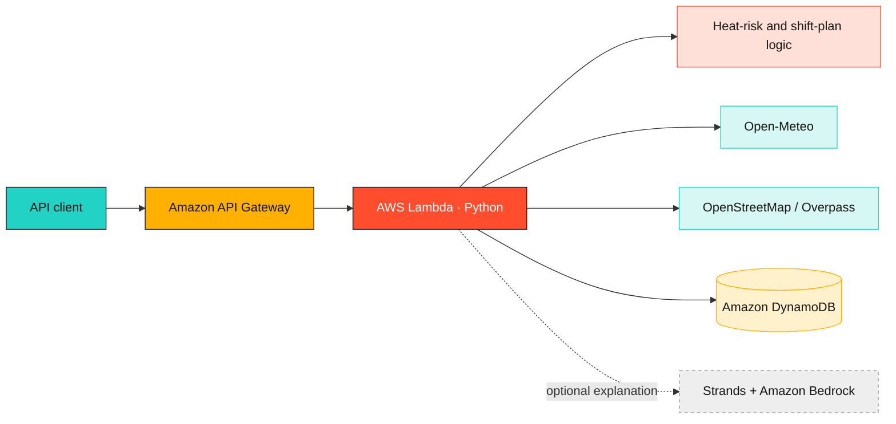
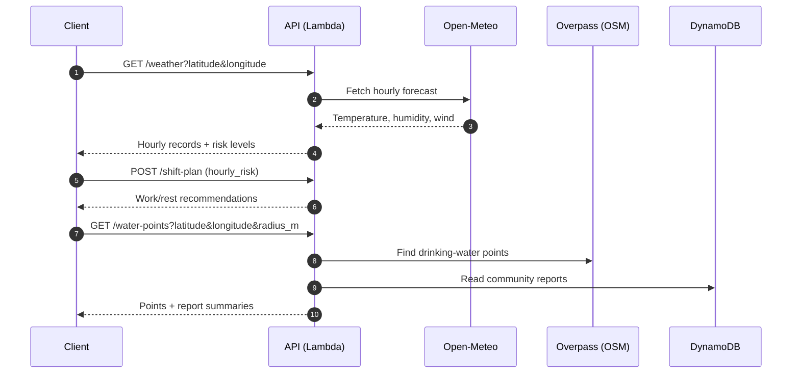
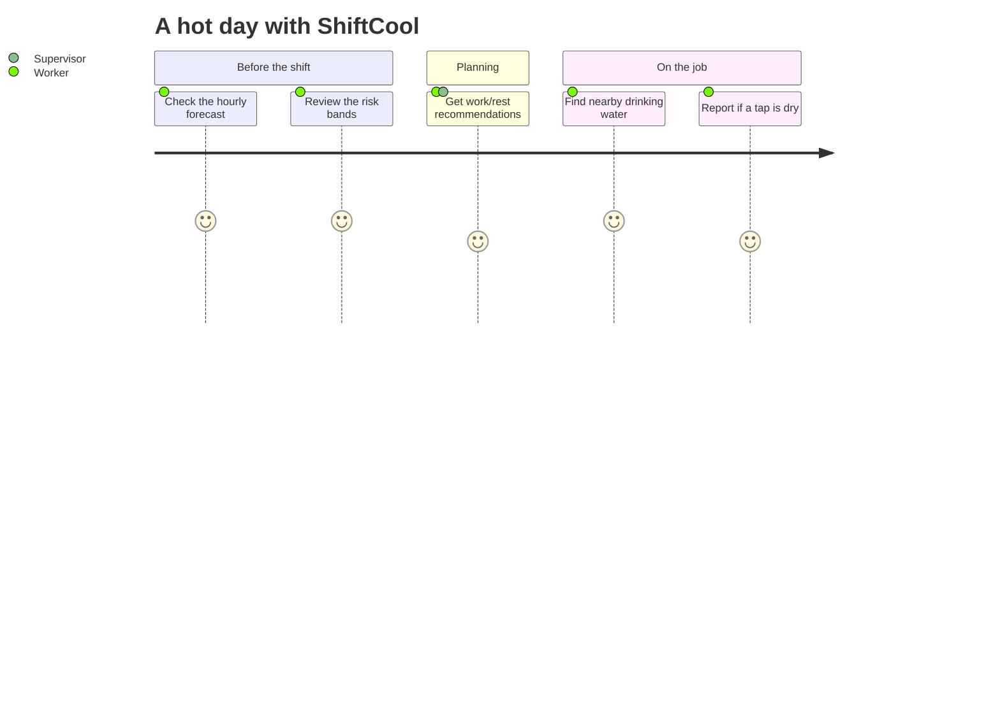
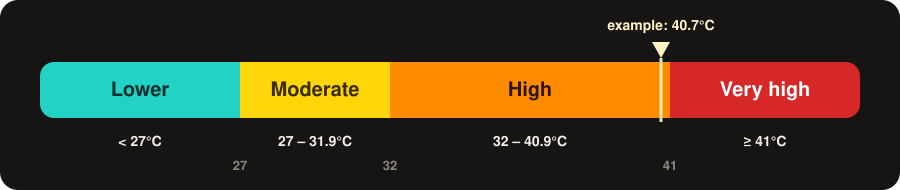

<div align="center">


<br>

<a href="https://github.com/Alcatraz234156/SHIFTCOOL">
  
</a>

<br>

<a href="https://github.com/Alcatraz234156/SHIFTCOOL"></a>


<a href="LICENSE"></a>

<br>


<br><br>

**[🚀 Get started](#-get-started)** &nbsp;•&nbsp;
**[⚙️ How it works](#%EF%B8%8F-how-it-works)** &nbsp;•&nbsp;
**[📡 API](#-api-reference)** &nbsp;•&nbsp;
**[🌡️ Heat-risk method](#%EF%B8%8F-heat-risk-method)** &nbsp;•&nbsp;
**[☁️ Deploy](#%EF%B8%8F-deploy-to-aws)**

</div>

<br>

> [!NOTE]
> **Built for Environmental Hacks · Track 2: Heat and Water.**
> ShiftCool brings a heat-risk dashboard, a shift-planning interface, and a nearby drinking-water map together in one prototype. Its Python API provides hourly forecasts, transparent heat-risk calculations, and community water-point reports.

> [!IMPORTANT]
> **Prototype status:** the dashboard currently runs on **bundled sample data**. The backend API is implemented separately, and the dashboard views are **not yet connected** to it.


## 🔥 Why ShiftCool?

Outdoor work doesn't pause when the temperature climbs. The hardest questions on a hot day are practical ones:

<table>
<tr>
<td align="center" width="33%">

### 🤔
**How bad is it right now?**<br>
<sub>Hourly conditions plus a humidity-adjusted screening indicator</sub>

</td>
<td align="center" width="33%">

### ⏰
**When should we work, and when should we rest?**<br>
<sub>Shift recommendations built from the hourly risk records</sub>

</td>
<td align="center" width="33%">

### 🚰
**Where can I get water?**<br>
<sub>Mapped drinking-water points with community status reports</sub>

</td>
</tr>
</table>

## ✨ At a glance

<table>
<tr>
<td width="33%" valign="top">

### 🌡️ Heat screening
Review hourly conditions and a **humidity-adjusted** screening indicator, so you can see when the day gets dangerous.

</td>
<td width="33%" valign="top">

### 🗓️ Shift planning
Explore sample work/rest guidance in the dashboard, with **backend recommendations** available through the API.

</td>
<td width="33%" valign="top">

### 💧 Water discovery
Browse sample map locations. The API can search **OpenStreetMap** for mapped drinking-water points.

</td>
</tr>
</table>

### 🧰 What's in the project

| | Component | What it does |
| :-: | --- | --- |
| ⚛️ | **Interactive React dashboard** | Heat, shift-planning, and water-map views |
| 🐍 | **Python API on AWS Lambda** | Open-Meteo forecasts, deterministic risk records, shift recommendations, water-point reports |
| 🗺️ | **OpenStreetMap / Overpass lookup** | Finds mapped drinking-water locations |
| 🗄️ | **DynamoDB report storage** | Stores community status updates |
| 🤖 | **Optional Strands + Amazon Bedrock** | AI explanations, *disabled by default* |

### 🧱 Tech stack

<p>
  
</p>


## ⚙️ How it works

The API turns a location into forecast records and a transparent risk summary. It can also look up mapped water points and combine them with saved community reports.



<details>
<summary><b>🔎 See a typical request, step by step</b></summary>

<br>



</details>

<details>
<summary><b>🧭 The intended worker journey</b></summary>

<br>



</details>

> The repository also includes a React dashboard with sample fixtures. Its current views are not wired to the API client yet.


## 🚀 Get started

| Step | What you need | Time |
| :-: | --- | :-: |
| **1** | Node.js 18+ and npm → run the dashboard | ~2 min |
| **2** | Python 3.12, AWS CLI, AWS SAM CLI → run the API locally | ~5 min |
| **3** | A deployed API URL → point the frontend at it | optional |

<details open>
<summary><b>⚛️ &nbsp;1 · Run the dashboard</b> &nbsp;<sub>Node.js 18+ and npm</sub></summary>

<br>

```powershell
cd frontend
npm install
npm run dev
```

Open the local URL printed by Vite, usually **`http://localhost:5173`**. The dashboard loads its bundled sample data without any API configuration.

Build for production:

```powershell
npm run build
```

The production bundle is written to `frontend/dist/`.

</details>

<details>
<summary><b>🐍 &nbsp;2 · Build and run the API locally</b> &nbsp;<sub>Python 3.12, AWS CLI, AWS SAM CLI</sub></summary>

<br>

```powershell
cd backend
python -m venv .venv
.\.venv\Scripts\Activate.ps1
python -m pip install -r requirements.txt
sam validate
sam build
sam local start-api
```

The local API is usually available at **`http://127.0.0.1:3000`**.

- 🌤️ Weather requests use **Open-Meteo**.
- 💧 Water-point requests use **Overpass** and read report data from DynamoDB.
- 🗄️ DynamoDB-backed routes need access to a configured table.

Once it's running, try it:

```powershell
curl http://127.0.0.1:3000/health
curl "http://127.0.0.1:3000/weather?latitude=12.97&longitude=77.59"
```

</details>

<details>
<summary><b>🔌 &nbsp;3 · Point the frontend at an API</b></summary>

<br>

The frontend API client reads `VITE_API_BASE_URL` from `frontend/.env.local`. To point it at a deployed API, create the local env file:

```powershell
cd frontend
Copy-Item .env.example .env.local
```

Set `VITE_API_BASE_URL` in `.env.local` to the API Gateway URL.

> [!NOTE]
> The dashboard views still use sample data until they are connected to that client.

</details>

<details>
<summary><b>🧪 &nbsp;Run backend unit tests</b></summary>

<br>

From `backend/`:

```powershell
python -m pip install pytest
python -m pytest tests
```

</details>


## 📡 API reference

Successful responses are JSON. Errors use `{ "error": "message" }`.

| Method | Route | Purpose |
| :-: | --- | --- |
|  | `/health` | Check API health |
|  | `/weather?latitude={lat}&longitude={lon}` | Two days of hourly forecast and risk records |
|  | `/shift-plan` | Create recommendations from an `hourly_risk` array |
|  | `/explain` | Explain a supplied plan when optional AI explanations are enabled |
|  | `/water-points?latitude={lat}&longitude={lon}&radius_m={meters}` | Find mapped drinking-water points and report summaries |
|  | `/water-points/{point_id}/reports` | Save a community status report |

<details>
<summary><b>📥 Example: <code>POST /shift-plan</code> request</b></summary>

<br>

```json
{
  "hourly_risk": [
    {
      "time": "2026-10-10T12:00",
      "temperature_c": 36.2,
      "relative_humidity": 58,
      "wind_speed_kmh": 11,
      "apparent_temperature_c": 41.0,
      "risk_level": "very_high"
    }
  ]
}
```

</details>

<details>
<summary><b>💧 Water-report statuses</b></summary>

<br>


</details>


## 🌡️ Heat-risk method

The backend calculates a humidity-adjusted screening temperature:

```text
apparent temperature = air temperature
                     + (relative humidity / 100)
                     × max(0, air temperature - 14°C)
                     × 0.35
```

<div align="center">
  
</div>

<br>

| Apparent temperature | Screening band |
| ---: | :-- |
| `< 27°C` |  |
| `27–31.9°C` |  |
| `32–40.9°C` |  |
| `≥ 41°C` |  |

<details>
<summary><b>🧮 Worked example</b></summary>

<br>

For an air temperature of **36.2 °C** and **58 %** relative humidity:

```text
36.2 + (58 / 100) × (36.2 - 14) × 0.35
= 36.2 + 0.58 × 22.2 × 0.35
≈ 40.7 °C
```

That lands just under the 41 °C line, in the **High** band. The sample request above carries a pre-filled `41.0` / `very_high` record purely to illustrate the payload shape.

</details>

<details>
<summary><b>🗺️ Quick-reference grid (apparent temperature, °C)</b></summary>

<br>

🟦 Lower &nbsp; 🟨 Moderate &nbsp; 🟧 High &nbsp; 🟥 Very high

| Air temp | 30% RH | 50% RH | 70% RH | 90% RH |
| ---: | :-: | :-: | :-: | :-: |
| **28°C** | 🟨 29.5 | 🟨 30.4 | 🟨 31.4 | 🟧 32.4 |
| **32°C** | 🟧 33.9 | 🟧 35.1 | 🟧 36.4 | 🟧 37.7 |
| **36°C** | 🟧 38.3 | 🟧 39.9 | 🟥 41.4 | 🟥 42.9 |
| **40°C** | 🟥 42.7 | 🟥 44.5 | 🟥 46.4 | 🟥 48.2 |
| **44°C** | 🟥 47.1 | 🟥 49.2 | 🟥 51.4 | 🟥 53.5 |

<sub>Computed with the formula above. Notice how humidity alone can push the same air temperature into a higher band.</sub>

</details>

> [!WARNING]
> These bands are a decision-support indicator, **not WBGT**. The calculation does not account for solar radiation, wind exposure, clothing, exertion, acclimatization, shade, medical factors, or workplace controls. Follow local heat-safety guidance, employer procedures, supervisor instructions, and emergency protocols. A lower indicator does not guarantee safe working conditions.


## ☁️ Deploy to AWS

From `backend/`:

```powershell
sam build
sam deploy --guided
```

The SAM template defines:

- 🧠 the **Lambda** function
- 🚪 **API Gateway** routes
- 🗄️ the **DynamoDB** reports table
- 🔒 an **encrypted S3 bucket**

After deployment, use the **`ApiUrl`** output as `VITE_API_BASE_URL` when configuring the frontend API client.

<details>
<summary><b>🤖 &nbsp;Enable optional AI explanations</b></summary>

<br>

AI explanations are **disabled by default**. To enable them, set `ENABLE_AI_EXPLANATION=true` for the Lambda and ensure the selected Bedrock model is available and permitted in your AWS region.

> [!CAUTION]
> Review AWS costs and hackathon rules before enabling it.

</details>

## 🗂️ Repository layout

<details>
<summary><b>Expand the project tree</b></summary>

<br>

```text
SHIFTCOOL/
├── assets/                     # README graphics
├── backend/
│   ├── src/
│   │   ├── app.py              # Lambda routes and external integrations
│   │   ├── heat_risk.py        # Deterministic risk calculations
│   │   └── ai_explanation.py   # Optional Strands / Bedrock explanation
│   ├── tests/
│   ├── requirements.txt
│   └── template.yaml           # SAM resources and API routes
├── frontend/
│   ├── src/
│   │   ├── components/         # Dashboard views
│   │   ├── services/           # Sample data and API client
│   │   └── types/              # TypeScript domain types
│   ├── .env.example
│   └── package.json
├── LICENSE
└── README.md
```

</details>

## 🧭 Project status

- [x] Heat-risk dashboard with sample data
- [x] Shift-planning view with sample data
- [x] Water-map view with sample locations
- [x] Python API: weather, risk records, shift plans, water points, community reports
- [x] Optional AI explanations (off by default)
- [ ] Connect dashboard views to the API client

## ❓ FAQ

<details>
<summary><b>Does the dashboard use live weather today?</b></summary>

<br>

Not yet. The dashboard runs on bundled sample data. The API serves live Open-Meteo forecasts, but the dashboard views aren't connected to it yet.

</details>

<details>
<summary><b>Is the risk indicator the same as WBGT?</b></summary>

<br>

No. It's a humidity-adjusted screening temperature meant for decision support. It ignores solar radiation, wind exposure, clothing, exertion, acclimatization, and more. Always follow local guidance and employer procedures.

</details>

<details>
<summary><b>Can I trust a water point on the map?</b></summary>

<br>

Treat it as a lead, not a guarantee. OpenStreetMap data may be incomplete, stale, or incorrectly tagged, and community reports can be outdated. Check freshness and confidence information.

</details>

<details>
<summary><b>Will AI explanations run automatically?</b></summary>

<br>

No. They're off by default and only run when you set `ENABLE_AI_EXPLANATION=true`.

</details>


## 🛡️ Data and responsible use

> [!CAUTION]
> ShiftCool is decision-support software, **not** a medical, occupational-health, or emergency-response system.

- 🌦️ Forecasts are estimates and can change.
- 🗺️ OpenStreetMap data may be incomplete, stale, inaccessible, or incorrectly tagged.
- 🚰 A map point does not prove that drinking water is currently available.
- 💬 Community reports can be uncertain or outdated; check freshness and confidence information.
- ⏱️ Respect the Overpass API usage policy and rate limits.

## 🙏 Built with

[Open-Meteo](https://open-meteo.com/) for forecasts · [OpenStreetMap](https://www.openstreetmap.org/) and the [Overpass API](https://overpass-api.de/) for water points · [AWS SAM](https://aws.amazon.com/serverless/sam/) for the backend · [React](https://react.dev/) and [Vite](https://vitejs.dev/) for the dashboard.

## 📄 License

This project is licensed under the [MIT License](LICENSE).

<br>

<div align="center">

**Built with ☀️ for the people who work in it.**

<sub>If ShiftCool is useful to you, a ⭐ on the repo goes a long way.</sub>

<br><br>


</div>
