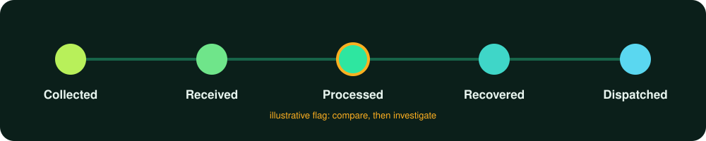
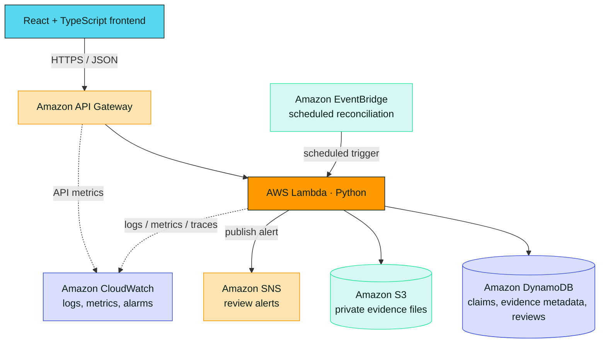
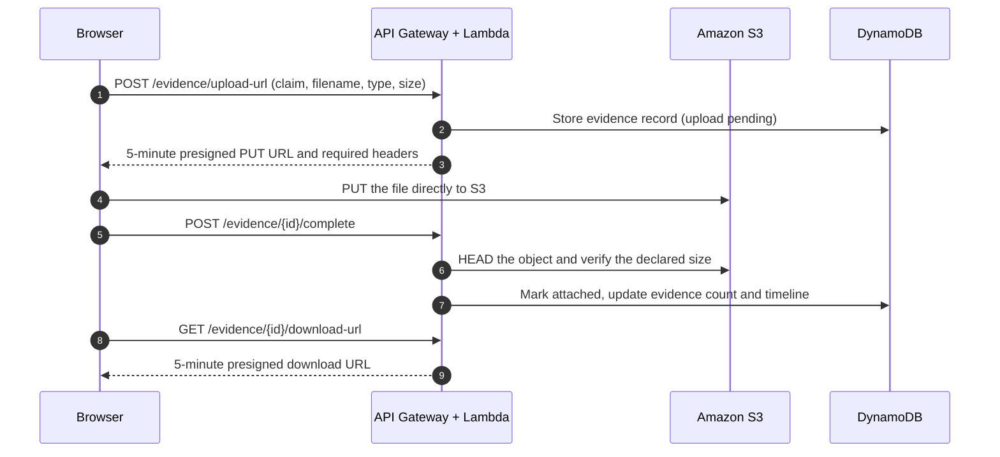
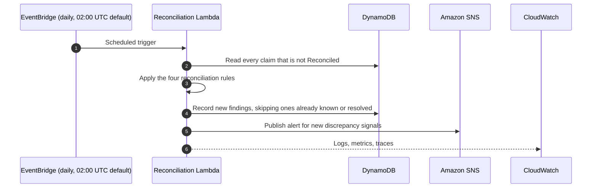
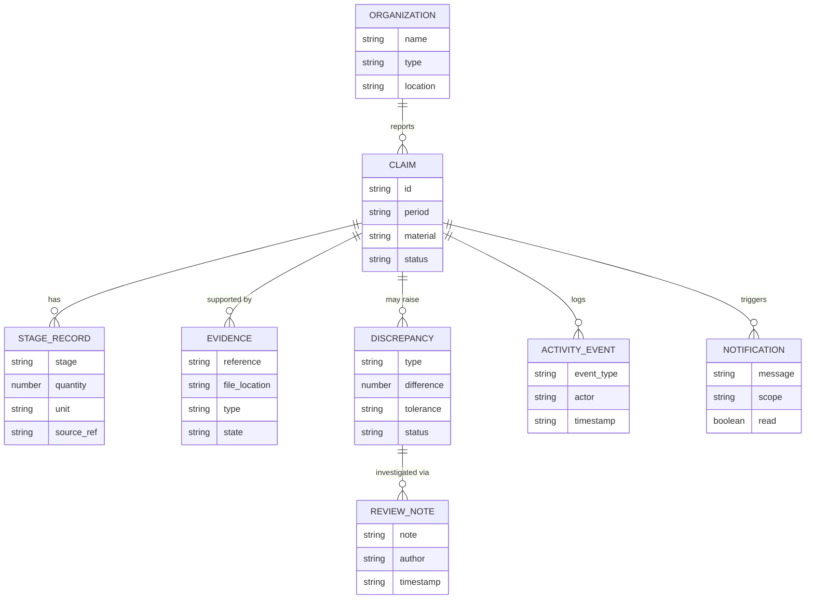

<div align="center">



<br>


<br>


<br>


<br><br>

**[ Overview](#-overview)** &nbsp;•&nbsp;
**[ Features](#-features)** &nbsp;•&nbsp;
**[ Architecture](#-system-architecture)** &nbsp;•&nbsp;
**[ Get started](#-getting-started)** &nbsp;•&nbsp;
**[ Deploy](#-aws-deployment)** &nbsp;•&nbsp;
**[ API](#-api-reference)** &nbsp;•&nbsp;
**[ Security](#-security-and-privacy)**

</div>

<br>

> [!IMPORTANT]
> A discrepancy is a **signal for investigation, not proof of fraud**. CycleProof supports evidence-based human review. It does not automatically establish that an environmental claim is true or false.

> [!NOTE]
> **Integration status:** the AWS backend in `backend/` is **complete and tested**: 24 API routes, a reconciliation engine, evidence storage, nightly checks, and alerts, all defined in one AWS SAM template. The browser UI still runs on **local mock data by default**. A typed API client is ready in `frontend/src/services/api.ts`, but it is not yet called from the UI store (see [Current status](#-current-status)).

<details>
<summary><b> &nbsp;Table of contents</b></summary>

<br>

- [Overview](#-overview)
- [The problem](#-the-problem)
- [The solution](#-the-solution)
- [Features](#-features)
- [Current status](#-current-status)
- [How it works](#-how-it-works)
- [System architecture](#-system-architecture)
- [Technology stack](#-technology-stack)
- [Project structure](#-project-structure)
- [Getting started](#-getting-started)
- [Environment configuration](#-environment-configuration)
- [Running locally](#-running-locally)
- [AWS deployment](#-aws-deployment)
- [API reference](#-api-reference)
- [Data model](#-data-model)
- [AWS services](#-aws-services)
- [Security and privacy](#-security-and-privacy)
- [Testing](#-testing)
- [Troubleshooting](#-troubleshooting)
- [Roadmap](#-roadmap)
- [Contributing](#-contributing)
- [Disclaimer](#-disclaimer)

</details>


##  Overview

CycleProof is a **full-stack environmental claim reconciliation platform** for the electronic-waste (e-waste) recycling chain. It helps organizations and reviewers compare reported material quantities with operational records, inspect supporting evidence, identify missing documentation, and investigate inconsistencies across the material lifecycle.

A recycling claim may describe material **collected, received at a facility, processed, recovered, or dispatched**. Those records can be produced by different organizations and stored in different formats. CycleProof brings claims, evidence, material-flow records, discrepancy findings, and review history into one unified workflow.

<div align="center">
  
</div>

<br>

The application combines a **web frontend** with a **serverless AWS backend**. The frontend provides dashboards and review tools. The backend exposes a JSON API, stores application records, manages private evidence files, runs the reconciliation rules on demand and every night, and raises alerts when new discrepancy signals appear.

##  The problem

Environmental and recycling claims are hard to evaluate when supporting records are fragmented across spreadsheets, documents, organizations, and facilities. Reviewers may have to compare multiple quantities and references by hand to determine:

| | Question |
| :-: | --- |
|  | Whether reported quantities **align** across the recycling chain |
|  | Whether the **evidence** needed to support a claim is present |
|  | Where an **unexplained difference** appears |
|  | Whether records contain **duplicate or inconsistent** information |
|  | Which claims **need review**, and what actions have already been taken |

That process is slow and hard to audit when records and explanations are scattered.

##  The solution

CycleProof organizes the process around three connected concepts.

<table>
<tr>
<td width="33%" valign="top">

###  Claims
Reported environmental or material-handling **quantities**.

</td>
<td width="33%" valign="top">

###  Evidence and records
The **documents and operational records** used to support those claims.

</td>
<td width="33%" valign="top">

###  Reconciliation and review
**Comparisons** that surface inconsistencies and help reviewers document their conclusions.

</td>
</tr>
</table>

The system keeps the relationships between claims, organizations, material stages, evidence, discrepancies, and review events, so a user can investigate an issue without losing the context behind it.


##  Features

| | Feature | What it does |
| :-: | --- | --- |
|  | **Dashboard** | Claims, pending reviews, evidence gaps, open discrepancies, and recent activity in one view |
|  | **Claims explorer** | Search, filter, sort, and inspect claims by organization, material, period, review status, and more |
|  | **Claim details** | A full workspace: reported quantities, evidence, reconciliation results, discrepancies, notes, and history |
|  | **Material journey** | Follow Collected → Received → Processed → Recovered → Dispatched and see where information stops reconciling |
|  | **Discrepancy explorer** | Quantity mismatches, missing evidence, possible duplicates, and inconsistent dates or identifiers, each with its comparison, explanation, status, and source records |
|  | **Evidence management** | Upload and manage supporting documents, link them to claims or stages, and import structured CSV records with validation and preview |
|  | **Organizations and facilities** | Profiles for collection centers, recyclers, processing, recovery, and dispatch sites, with their claims and review history |
|  | **Activity timeline** | Evidence changes, quantity updates, review notes, and status transitions in order |
|  | **Notifications** | Review tasks, new discrepancies, missing evidence, and other items needing attention |
|  | **Analytics and reporting** | Reconciliation outcomes, quantities, evidence completeness, and discrepancy trends, with claim-level and filtered reports |
|  | **Settings and onboarding** | Preferences, reconciliation thresholds where authorized, and a walkthrough of the review workflow |
|  | **Automated reconciliation** | Four rules (quantity mismatch, missing evidence, duplicate records, date inconsistency) run on demand per claim and nightly across open claims. Findings are deterministic, so reruns never create duplicates |
|  | **Human-centered review** | Reviewers add explanations, request information, update statuses, and record outcomes. Automated flags stay separate from human decisions |

> [!NOTE]
> Production audit guarantees for the activity timeline depend on the deployed implementation and configuration.

##  Current status

| Area | State |
| --- | --- |
| **Backend** | **Complete.** 24 routes on API Gateway → Lambda (Python 3.12, arm64) → single-table DynamoDB, with private S3 evidence storage, a rule-based reconciliation engine, nightly EventBridge reconciliation, SNS alerts, and CloudWatch alarms |
| **Backend tests** | 43 automated tests pass: rule unit tests plus API tests against mocked AWS (moto) |
| **Infrastructure** | One SAM template (`backend/template.yaml`) defines every resource. Deploy with `sam build` and `sam deploy --guided` |
| **Demo data** | `backend/scripts/seed.py` loads the same dataset the UI uses into a deployed table |
| **Frontend** | Full review UI running on local mock records by default |
| **Frontend ↔ backend** | `frontend/src/services/api.ts` is a typed client for the routes the UI needs (every route except `GET /discrepancies/{id}`), including the three-step evidence upload. It is **not yet called from the UI store** (`useAppState`), so UI actions do not persist to AWS until that wiring is done. Set `VITE_API_BASE_URL` to the deployed API to enable the client |
| **Not yet included** | Authentication and tenant-level authorization, per-stage tolerances, malware scanning, email subscriptions, and a production audit guarantee |

##  How it works



```mermaid
flowchart LR
    A[1 · Create or<br/>import a claim] --> B[2 · Attach records<br/>and evidence]
    B --> C[3 · Reconcile<br/>quantities]
    C --> D[4 · Investigate<br/>flagged differences]
    D --> E[5 · Record a<br/>review outcome]
    E --> F[6 · Track<br/>the history]
    F --> G[7 · Generate<br/>a report]

    style A fill:#b8f05a,stroke:#0b1f1a,color:#0b1f1a
    style B fill:#8fe97b,stroke:#0b1f1a,color:#0b1f1a
    style C fill:#2ee6a0,stroke:#0b1f1a,color:#0b1f1a
    style D fill:#ffe3b0,stroke:#ffb020,color:#0b1f1a
    style E fill:#3fd6c8,stroke:#0b1f1a,color:#0b1f1a
    style F fill:#5ad7f0,stroke:#0b1f1a,color:#0b1f1a
    style G fill:#9dbcff,stroke:#0b1f1a,color:#0b1f1a
```

1. **Create or import a claim.** Capture the organization, reporting period, material, and claimed quantities.
2. **Attach records and evidence.** Associate operational records and documents with the claim and the relevant material stages.
3. **Reconcile available quantities.** Compare compatible values across the material journey using configured rules.
4. **Investigate flagged differences.** Review the values, source records, missing evidence, and explanation for each finding.
5. **Record a review outcome.** Add notes, request more information, or update the discrepancy and claim status.
6. **Track the history.** Inspect relevant activity and notification records.
7. **Generate a report.** Export or print a summary of the claim, reconciliation, evidence, and review outcome.

##  System architecture

CycleProof uses a client-server architecture. The browser application talks to an API, and backend functions validate requests and interact with persistent storage.



> [!NOTE]
> The backend in `backend/` defines these seven AWS services in AWS SAM, plus CloudWatch alarms that notify the same SNS topic. Verify the deployed stack and outputs before describing the cloud environment as live. Authentication and tenant-level authorization must be added before using real organizational data.

<details>
<summary><b> &nbsp;Flow: evidence upload</b></summary>

<br>



The bucket is private, versioned, encrypted, and blocks public access, so the browser never receives standing access to evidence files. The declared file size is part of the upload signature, so S3 rejects an upload of a different size, and `complete` double-checks it. Only CSV, PDF, PNG, and JPEG files up to 25 MB are accepted. A download URL is only issued once the upload is complete.

</details>

<details>
<summary><b> &nbsp;Flow: scheduled reconciliation</b></summary>

<br>



SNS only publishes. Add and confirm an email or other endpoint subscription in the AWS console to receive alerts. The same topic also receives the CloudWatch alarm notifications for Lambda errors.

</details>


##  Technology stack


<table>
<tr>
<td width="33%" valign="top">

###  Frontend
- React
- TypeScript
- Vite
- CSS and reusable UI components

</td>
<td width="33%" valign="top">

###  Backend
- Python 3.12 with boto3
- AWS Lambda (arm64), two functions: API and scheduled reconciliation
- Amazon API Gateway (REST, throttled)
- Amazon DynamoDB, single table with two GSIs
- Amazon S3 for private evidence
- Amazon EventBridge for nightly reconciliation
- Amazon CloudWatch for JSON logs, metrics, X-Ray tracing, and error alarms
- Amazon SNS for alert delivery
- AWS SAM for infrastructure definition and deployment

</td>
<td width="33%" valign="top">

###  Dev and testing
- Node.js and npm
- Python and pip
- `unittest` with moto for API tests against mocked AWS
- AWS SAM CLI
- Docker, where `sam local` needs it
- Git

</td>
</tr>
</table>

Refer to the repository manifests and the SAM template for exact dependency versions and configured resources.

##  Project structure

The repository contains a frontend application and an AWS SAM backend.

<details>
<summary><b>Expand the tree</b></summary>

<br>

```text
CycleProof/
├── README.md
├── assets/                        # README graphics and icons
├── backend/
│   ├── README.md                  # backend reference: routes, rules, data model
│   ├── template.yaml              # SAM stack: API, table, bucket, 2 functions, SNS, alarms
│   ├── samconfig.toml.example
│   ├── requirements.txt
│   ├── requirements-dev.txt       # adds moto for the API tests
│   ├── .env.example
│   ├── src/
│   │   ├── app.py                 # router, route handlers, scheduled handler
│   │   ├── reconciliation.py      # pure rules, no AWS calls
│   │   ├── validation.py          # input validation and enums
│   │   └── db.py                  # DynamoDB access layer
│   ├── scripts/seed.py            # load demo data into a table
│   ├── seed/seed_data.json
│   └── tests/
│       ├── test_reconciliation.py
│       └── test_api.py
└── frontend/
    ├── package.json
    ├── package-lock.json
    ├── vite.config.ts
    ├── .env.example
    └── src/
        ├── components/
        ├── services/              # api.ts is the typed backend client
        ├── store/
        ├── types/
        ├── data/                  # local mock records
        ├── App.tsx
        └── main.tsx
```

Use the actual repository files as the source of truth if the layout changes.

</details>

##  Getting started

<details open>
<summary><b>1 · Prerequisites</b></summary>

<br>

- **Node.js 18** or newer, and npm
- **Python 3.12**, which matches the Lambda runtime in the SAM template
- **AWS SAM CLI**
- **Docker**, only if you use `sam local start-api`
- **AWS CLI**, for deployment
- An **AWS account** and credentials with permissions appropriate to the resources being deployed

```bash
node --version
npm --version
python --version
sam --version
aws --version
docker --version
```

A tool is only required for the commands that use it. Docker is not necessary for every SAM workflow.

</details>

<details open>
<summary><b>2 · Get the source code</b></summary>

<br>

```bash
git clone <YOUR_REPOSITORY_URL>
cd <YOUR_REPOSITORY_DIRECTORY>
```

Replace the placeholders with your repository URL and directory.

</details>

##  Environment configuration

### Frontend

Copy `frontend/.env.example` to `frontend/.env` and set the API base URL. Leave it empty to keep using the built-in mock data.

```bash
VITE_API_BASE_URL=https://<api-id>.execute-api.<region>.amazonaws.com/v1
```

Use the `ApiBaseUrl` value from the stack outputs after deployment.

### Backend

The SAM template sets these on both Lambda functions, so you normally never create them by hand. `backend/.env.example` documents them for local work.

| Variable | Purpose |
| --- | --- |
| `TABLE_NAME` | DynamoDB table (`cycleproof-<env>-records`) |
| `EVIDENCE_BUCKET` | Private S3 bucket for evidence files |
| `ALERT_TOPIC_ARN` | SNS topic that receives review alerts |
| `APP_ENV` | `dev`, `staging`, or `prod` |
| `ALLOWED_ORIGIN` | Exact frontend origin allowed by CORS |
| `DISCREPANCY_TOLERANCE_PCT` | Default tolerance before a quantity difference is flagged (5) |

### SAM parameters

| Parameter | Default | Notes |
| --- | --- | --- |
| `AppEnvironment` | `dev` | Also prefixes resource names |
| `AllowedOrigin` | `http://localhost:5173` | Must be the exact frontend origin. Do not use `*` in production |
| `DiscrepancyTolerancePct` | `5` | 0 to 100 |

For a deployment, copy `backend/samconfig.toml.example` to `backend/samconfig.toml` and edit the region and origin. The nightly schedule is fixed at 02:00 UTC in the template.

> [!CAUTION]
> Do not commit secrets, AWS access keys, credentials, private evidence, or production environment files. `.gitignore` already excludes `.env`, `samconfig.toml`, and `.aws-sam/`. Prefer IAM roles and managed secret storage. Never put secrets in `VITE_*` variables, because they are bundled into client-side code.

##  Running locally

<details open>
<summary><b> &nbsp;Frontend</b></summary>

<br>

```bash
cd frontend
npm install
npm run dev        # start the dev server
npm run build      # type-check and create a production bundle
```

Open the local URL printed by Vite in the terminal.

</details>

<details open>
<summary><b> &nbsp;Backend</b></summary>

<br>

Open a separate terminal. See `backend/README.md` for backend-specific notes.

```bash
cd backend
python -m pip install -r requirements-dev.txt
python -m unittest discover -s tests -v     # 43 tests, no AWS account needed
sam validate
sam build
```

The API tests run against mocked AWS (moto), so they need no credentials. `sam local start-api` additionally needs Docker, and routes that touch DynamoDB or S3 need real resources and credentials.

> [!NOTE]
> Local execution does not create or populate cloud resources. Deploy the stack first, then load demo data with `backend/scripts/seed.py`.

</details>

##  AWS deployment

> [!WARNING]
> Deploying creates or updates cloud resources and may incur AWS charges. Review the template, permissions, region, and expected costs before proceeding.

<details>
<summary><b>1 · Configure AWS credentials</b></summary>

<br>

Configure a suitable AWS CLI profile using your organization's approved method, then verify the identity and region before deploying.

```bash
aws sts get-caller-identity
aws configure list
```

Avoid pasting access keys into source code or README files.

</details>

<details>
<summary><b>2 · Validate and build</b></summary>

<br>

From the `backend` directory:

```bash
sam validate
sam build
```

Resolve template and build errors before deploying.

</details>

<details>
<summary><b>3 · Deploy</b></summary>

<br>

First-time guided deployment:

```bash
sam deploy --guided
```

Follow the prompts for stack name, AWS Region, and template parameters (`AppEnvironment`, `AllowedOrigin`, `DiscrepancyTolerancePct`). Set `AllowedOrigin` to the exact URL the frontend is served from. You can start from `backend/samconfig.toml.example`. Review the generated `samconfig.toml` before committing it, since it is environment-specific and `.gitignore` excludes it by default.

For later deployments, if the saved configuration is appropriate:

```bash
sam deploy
```

</details>

<details>
<summary><b>4 · Load demo data (optional)</b></summary>

<br>

The API never inserts demo data on its own. To load the dataset the frontend uses:

```bash
cd backend
export AWS_PROFILE=<profile> AWS_REGION=<region>
python scripts/seed.py --table cycleproof-dev-records          # dry run
python scripts/seed.py --table cycleproof-dev-records --yes    # write
```

The script refuses a table that already has claims (unless `--force`), tags every record `demo: true`, and advances the id counters so new claims do not collide with seeded ones.

</details>

<details>
<summary><b>5 · Configure the frontend</b></summary>

<br>

Copy the API base URL from the deployment outputs or the API Gateway console, set the frontend environment variable to it, and rebuild:

```bash
npm run build
```

Deploy the resulting static frontend with the hosting approach chosen for the project. Static hosting is a separate step unless the SAM template explicitly defines it.

</details>

<details>
<summary><b>6 · Subscribe to alerts</b></summary>

<br>

The stack creates an SNS topic for review alerts and Lambda error alarms, but no subscribers. In the AWS console, add an email or other endpoint subscription to the topic and confirm it. Without a confirmed subscription, scheduled-reconciliation alerts have nowhere to go.

</details>

<details>
<summary><b>7 · Verify the deployment</b></summary>

<br>

Test the deployed API and frontend with **non-sensitive sample data**, and confirm that:

- [ ] `GET /health` and `GET /bootstrap` return `200` from the `ApiBaseUrl`
- [ ] API routes return the expected status codes and response formats
- [ ] Lambda functions can access only the resources they need
- [ ] DynamoDB operations persist and retrieve the expected records
- [ ] An evidence upload completes (`upload-url`, `PUT`, `complete`) and its download URL works
- [ ] Browser requests work with the intended CORS configuration
- [ ] Logs are useful for diagnosis without exposing sensitive data
- [ ] The scheduled reconciliation runs and its logs appear in CloudWatch
- [ ] A confirmed SNS subscription receives a test alert

</details>

<details>
<summary><b>8 · Clean up test resources</b></summary>

<br>

If the deployment is only a disposable test, review the stack and its retained resources before deleting it. Cloud resources, data, or buckets may have retention policies or deletion protections.

```bash
sam delete
```

The evidence bucket is versioned, and CloudFormation cannot delete a bucket that still holds objects. Empty it, including old versions, before running `sam delete`. Use this only when you understand which resources the stack will remove and have backed up any data you need.

</details>


##  API reference

The backend serves **24 routes** under the `ApiBaseUrl` stack output (it ends in `/v1`). `backend/template.yaml` routes everything through one proxy, and `backend/src/app.py` owns routing, so that file is the authoritative reference. Full request and response notes are in [`backend/README.md`](backend/README.md).

| Method | Route | Purpose |
| :-: | --- | --- |
|  | `/health` | Health check |
|  | `/bootstrap` | Everything the UI needs in one call: claims, organizations, evidence, discrepancies, timeline, notifications |
|  | `/organizations` | List organizations |
|  | `/organizations` | Create an organization (`name`, `type`; optional `location`, `registrationId`, `contactName`, `status`) |
|  | `/organizations/{orgId}` | One organization. Claim totals, open discrepancies, and evidence gaps are computed live, never stored |
|  | `/claims` | List claims. Filter with `status`, `orgId`, `period`, `assignedReviewer` |
|  | `/claims` | Create a claim (`orgId`, `period`, `claimed`; optional stage quantities). Ids are sequential, e.g. `CP-2026-017` |
|  | `/claims/{claimId}` | One claim. `?include=related` adds evidence, discrepancies, and timeline |
|  | `/claims/{claimId}` | Update status, reviewer notes, assigned reviewer, evidence count, and stage quantities. Status and quantity changes are written to the timeline |
|  | `/claims/{claimId}/reconcile` | Run reconciliation now. Optional `{ "tolerancePct": 0-100 }`. Idempotent |
|  | `/claims/{claimId}/timeline` | Activity history for the claim |
|  | `/claims/{claimId}/notes` | Add a review note `{ note, discrepancyId? }` |
|  | `/claims/{claimId}/report` | Report data: stages, evidence, discrepancies, timeline, summary, and disclaimer |
|  | `/claims/{claimId}/imports` | Import CSV-derived rows (max 1,000). All-or-nothing: one invalid row rejects the batch |
|  | `/discrepancies` | List discrepancies. Filter with `claimId`, `status`, `type`, `orgId` |
|  | `/discrepancies/{id}` | One discrepancy |
|  | `/discrepancies/{id}` | Update `status` and `reviewerNotes`. These are human decisions and set `reviewedAt` and `resolvedAt` |
|  | `/notifications` | List notifications (`?unread=true`) |
|  | `/notifications/{id}` | Mark one notification read or unread `{ "read": true }` |
|  | `/notifications/read-all` | Mark every notification read |
|  | `/evidence` | List evidence (`?claimId=`) |
|  | `/evidence/upload-url` | Step 1 of an upload: returns a 5-minute presigned `PUT` URL |
|  | `/evidence/{id}/complete` | Step 3: verify the object exists in S3 with the declared size, then mark it attached |
|  | `/evidence/{id}/download-url` | 5-minute presigned download URL, available once the upload is complete |

### Conventions

- All request and response bodies are JSON. Request bodies are limited to 2 MB.
- Errors look like `{ "error": "message", "details": [...] }`. Unknown routes return `404` and wrong methods return `405`.
- List endpoints accept `?limit=` (1 to 1000, default 200) and `?cursor=`, and return `{ items, nextCursor? }`.
- CORS allows only the configured `AllowedOrigin`. Gateway-generated errors (throttling, 5xx) carry the same CORS header, so the browser shows the real error.
- The API is throttled at 50 requests per second with bursts of 100.

### Evidence upload in three steps

1. `POST /evidence/upload-url` with `claimId`, `filename`, `contentType` (`text/csv`, PDF, PNG, or JPEG), and `sizeBytes` (up to 25 MB).
2. `PUT` the file to the returned `uploadUrl`, sending the returned `headers`.
3. `POST /evidence/{id}/complete` so the backend verifies the file and updates counts and the timeline.

`api.uploadEvidence()` in `frontend/src/services/api.ts` performs all three steps.

### CSV imports

`POST /claims/{claimId}/imports` takes `{ records: [{ reference_id, record_type, quantity_tonnes, date, source }] }`. `record_type` is a stage name. A blank quantity stays `null`, and any invalid row rejects the whole batch, with up to 20 row errors in `details`.

> [!NOTE]
> The browser UI is still local-first by default. The typed client in `frontend/src/services/api.ts` covers the routes the UI needs, but the UI store does not call it yet. Wire it into the store's actions before expecting UI changes to persist to AWS.

> [!WARNING]
> The API has **no authentication yet**. Anyone who can reach it can read and change all data. Add an identity provider and an API Gateway authorizer before using real data. CORS and input validation are not authorization.

##  Data model



<details>
<summary><b> &nbsp;Logical entities in detail</b></summary>

<br>

| Entity | Typical fields |
| --- | --- |
| **Claim** | identifier, organization, reporting period, material type, claimed quantities, status |
| **Organization or facility** | identifier, name, type, location, associated claims |
| **Material-stage record** | claim, lifecycle stage, quantity, unit, timestamp, source reference |
| **Evidence metadata** | document reference, file location, type, related claim or stage, uploader, availability state |
| **Discrepancy** | type, compared values, difference, configured tolerance, explanation, investigation status |
| **Review note** | related claim or discrepancy, note, author, timestamp |
| **Activity event** | event type, target record, description, actor, timestamp |
| **Notification** | recipient or scope, message, related record, timestamp, read state |

The backend stores all of these in **one DynamoDB table** with `PK`/`SK` keys (`SK` is always `META`), for example `CLAIM#CP-2026-001`, `EVIDENCE#ev-…`, and `DISCREPANCY#disc-…`.

- **GSI1** (`GSI1PK` is the entity type) lists everything of one kind, newest first.
- **GSI2** (`GSI2PK` is `CLAIM#<id>`) returns everything that belongs to a claim in one query: evidence, discrepancies, timeline, and notifications.
- `COUNTER#…` items hold the sequential id counters.
- The table uses on-demand billing, encryption at rest, and point-in-time recovery.

See `backend/src/db.py` for the access patterns.

</details>

###  Reconciliation rules

Findings are **review signals, not proof of fraud**. Each one carries the compared values, the tolerance, and a plain-language explanation. The rules live in `backend/src/reconciliation.py`, which has no AWS dependencies.

| Rule | Triggered when |
| --- | --- |
| **Quantity mismatch** | Two compatible values differ by more than the tolerance (default 5%): claimed vs collected, then each adjacent stage Collected → Received → Processed → Recovered → Dispatched. Both values must exist |
| **Missing evidence** | An evidence record is marked missing, or a stage has a reported quantity but no attached evidence for that stage |
| **Duplicate record** | The same reference appears more than once at the same stage within a claim |
| **Date inconsistency** | The earliest evidence of a later stage predates the earliest evidence of an earlier stage, or evidence is dated in the future |

Every finding has a deterministic id (a hash of the claim and rule fingerprint), so reruns never create duplicates, and a finding a reviewer has marked **Resolved** is not recreated. The nightly job (02:00 UTC) checks every claim that is not `Reconciled` and publishes one SNS alert if anything new was found. You can also run a single claim on demand with `POST /claims/{claimId}/reconcile`.

###  Reconciliation principles

| | Principle |
| :-: | --- |
|  | Compare values only when **units and contexts** are compatible |
|  | Keep **source values visible** next to calculated differences |
|  | **Explain which rule** triggered a discrepancy |
|  | Do not treat **missing data as zero** without an explicit, justified rule |
|  | Avoid percentages with a zero or missing denominator |
|  | Make **tolerances explicit** and configurable where appropriate |
|  | Keep **automated flags separate** from human decisions |
|  | Preserve **source references** so findings trace back to the underlying records |

##  AWS services

The infrastructure is defined in `backend/template.yaml` across **seven AWS services**.

| AWS service | Role in CycleProof |
| --- | --- |
| **Amazon API Gateway** | Regional REST API at stage `v1` with CORS locked to one origin and throttling (50 requests per second, burst 100) |
| **AWS Lambda** | Two Python 3.12 functions on arm64: `api-handler` (all routes) and `scheduled-reconciliation` (5-minute timeout). Each has least-privilege access to only what it needs |
| **Amazon DynamoDB** | Single table with two GSIs, on-demand billing, encryption at rest, and point-in-time recovery |
| **Amazon S3** | Private, versioned, encrypted evidence bucket with public access blocked, TLS-only access, and CORS limited to the frontend origin. The browser gets short-lived presigned URLs |
| **Amazon EventBridge** | Triggers scheduled reconciliation daily at 02:00 UTC |
| **Amazon CloudWatch** | JSON Lambda logs, X-Ray tracing, and two alarms that fire when either function reports errors |
| **Amazon SNS** | Encrypted topic that receives review alerts and the CloudWatch alarm notifications. Subscriptions must be configured separately |

> [!WARNING]
> Deployment creates billable resources. Review the AWS pricing page and account budgets before deploying. The backend does not include an identity provider, complete user authorization, email subscriptions, malware scanning, or a production audit guarantee.

##  Security and privacy

A full-stack deployment should apply controls appropriate to the sensitivity of the data.

<table>
<tr>
<td width="50%" valign="top">

###  Access and data
- **Least-privilege IAM:** the API function can only presign `PutObject`/`GetObject` under `evidence/*` and list the bucket
- Evidence lives in a **private, versioned, encrypted** S3 bucket with public access blocked and TLS enforced; the browser gets only 5-minute presigned URLs
- Upload size is part of the signature and is verified again on completion
- Every API payload is validated, and filenames, types, sizes, and ids are checked
- **CORS** allows only the configured frontend origin
- **Still to add:** authentication and tenant-level authorization before any real organizational data

</td>
<td width="50%" valign="top">

###  Hygiene and operations
- Keep secrets out of source control and frontend environment variables
- Use **HTTPS** for deployed traffic
- Uploads are limited to CSV, PDF, PNG, and JPEG at up to 25 MB, checked by declaration only, so add malware scanning and content verification for untrusted files
- Avoid logging document contents, credentials, or unnecessary personal information
- Define retention, backup, and deletion policies for evidence and review records
- Monitor errors and resource usage, and review CloudWatch logs for unexpected behavior

</td>
</tr>
</table>

### Before production

- **No authentication or tenant isolation.** Add Cognito (or another identity provider) with an API Gateway authorizer, and scope data per organization. Review and actor names on the timeline are generic ("Reviewer") until identities exist.
- **One global tolerance.** Processing and recovery legitimately lose mass, so a flat 5% flags normal yield loss. Agree per-stage tolerances with domain experts.
- **Malware scanning and content verification** for uploaded files.
- **Abandoned uploads** are not cleaned up: a started upload that never completes leaves a pending record and possibly an object. Add a cleanup job or S3 lifecycle rule.
- `/bootstrap` and the organization endpoints load full collections (capped at 5,000 per type). Move to paginated, filtered reads at scale.
- Review IAM policies, log and data retention, and the bucket and table deletion behavior for your environment.

> [!WARNING]
> The precise controls available depend on the authentication, storage, and deployment configuration that is actually implemented. Do not describe the application as secure or compliant solely because it uses AWS.

##  Testing

<details open>
<summary><b> &nbsp;Run the checks</b></summary>

<br>

Backend, from the `backend` directory:

```bash
python -m pip install -r requirements-dev.txt     # boto3 and moto
python -m unittest discover -s tests -v           # 43 tests
sam validate && sam build
```

The suite has two parts. `tests/test_reconciliation.py` covers the pure rules and needs no dependencies. `tests/test_api.py` exercises the real handlers against mocked DynamoDB, S3, and SNS, and is skipped automatically if `moto` is not installed.

Frontend, from the `frontend` directory:

```bash
npm install
npm run build
```

</details>

<details>
<summary><b> &nbsp;What is covered</b></summary>

<br>

**Covered by the backend suite**

- [x] Quantity reconciliation, tolerances, missing values, garbage values, and zero denominators
- [x] Missing-evidence, duplicate-record, and date-inconsistency rules
- [x] Deterministic finding ids, and resolved findings not being recreated
- [x] Request validation, malformed JSON, bad ids, `404` and `405`, CORS preflight
- [x] Sequential claim ids, claim and discrepancy updates, notes, and notifications
- [x] CSV import: all-or-nothing behavior, limits, and float storage
- [x] The full evidence upload flow, including size-mismatch rejection
- [x] Pagination, report and bootstrap payloads, and the scheduled handler

**Still worth adding**

- [ ] Authorization tests, once authentication exists
- [ ] Frontend workflow tests for search, filters, review actions, and reports
- [ ] End-to-end tests for a complete claim investigation against a deployed stack
- [ ] Deployment smoke tests after infrastructure changes

</details>

> [!CAUTION]
> Use isolated test resources and synthetic data. Never run destructive tests against production records.

##  Troubleshooting

<details>
<summary><b> &nbsp;Frontend cannot reach the API</b></summary>

<br>

- Confirm the API base URL is correct
- Verify the API is running or deployed
- Inspect the browser network panel and backend logs
- Check CORS configuration and request paths

</details>

<details>
<summary><b> &nbsp;API returns an error</b></summary>

<br>

- Inspect the HTTP status code and response body
- Check Lambda logs in CloudWatch for the relevant request
- Verify required environment variables and resource permissions
- Confirm the request matches the backend's validation schema

</details>

<details>
<summary><b> &nbsp;Lambda cannot access DynamoDB or S3</b></summary>

<br>

- Confirm the correct table or bucket name is configured
- Review the Lambda execution role and least-privilege policies
- Check the selected AWS Region and deployed stack outputs

</details>

<details>
<summary><b> &nbsp;SAM build or local invocation fails</b></summary>

<br>

- Validate the template
- Confirm Python and dependency versions match the configured Lambda runtime
- Check Docker availability if the build configuration requires it
- Read SAM output for the first underlying error instead of relying only on the final failure message

</details>

<details>
<summary><b> &nbsp;Evidence upload fails</b></summary>

<br>

- Only CSV, PDF, PNG, and JPEG up to 25 MB are accepted, and the file must match the declared `sizeBytes` exactly
- Presigned URLs last 5 minutes, so request a new one if it expired
- A `409` from `/complete` means the file was not uploaded yet or its size differs from the declared size
- Confirm the PUT sends the returned `headers`, and that `AllowedOrigin` matches the page's exact origin
- Verify S3 permissions, CORS rules, and content-type handling
- Avoid retrying destructive or duplicate operations without checking the resulting records

</details>

<details>
<summary><b> &nbsp;No review alerts arrive</b></summary>

<br>

- Add an email or other endpoint subscription to the SNS topic and confirm it
- Check that the scheduled reconciliation ran (daily at 02:00 UTC) in the Lambda's CloudWatch logs
- Alerts are published only when reconciliation finds new discrepancy signals
- The Lambda error alarms use the same topic, so a confirmed subscription covers both

</details>

<details>
<summary><b> &nbsp;UI changes don't persist to AWS</b></summary>

<br>

- The UI is local-first by default; set `VITE_API_BASE_URL` to the deployed API
- The typed client in `frontend/src/services/api.ts` is not yet called from the UI store, so wire it into the store's actions
- Mock records in the frontend are not uploaded automatically; load them with `backend/scripts/seed.py`

</details>


##  Roadmap

**Done**

- [x] Backend API: 24 routes covering claims, organizations, evidence, discrepancies, notes, notifications, imports, and reports
- [x] Reconciliation engine with four rules, deterministic findings, and nightly runs
- [x] Presigned, size-verified evidence uploads to a private S3 bucket
- [x] SNS alerts, CloudWatch alarms, and X-Ray tracing
- [x] Seed script and a 43-test backend suite
- [x] Typed frontend API client

**Next**

- [ ] Wire the API client into the frontend store so UI actions persist to AWS
- [ ] Add an identity provider and tenant-level authorization
- [ ] Per-stage tolerances, agreed with domain experts
- [ ] Malware scanning and cleanup of abandoned uploads
- [ ] Paginated reads in place of full-collection loads
- [ ] Alert subscriptions and any extra CloudWatch alarms
- [ ] Frontend and end-to-end test coverage
- [ ] Evaluate usability with recycling operators and compliance reviewers
- [ ] Document data retention and governance practices

##  Contributing

1. **Review** the current architecture and coding conventions before changing files.
2. **Keep frontend API types aligned** with backend request and response schemas.
3. **Add or update tests** when changing reconciliation logic or data contracts.
4. **Avoid committing** secrets, private data, build output, or local environment files.
5. **Run the relevant frontend and backend checks** before opening a pull request: `python -m unittest discover -s tests` in `backend/` and `npm run build` in `frontend/`.
6. **Describe** changed behavior, testing performed, and any known limitations.

##  Disclaimer

CycleProof is a software tool intended to support the review of environmental claims. It is not, by itself, a regulatory certification system, legal determination, or substitute for an independent audit. A discrepancy indicates that information may need further investigation; it does not establish fraud, intent, or environmental impact. Conclusions should be based on reliable evidence and qualified human review.

<br>

<div align="center">

**CycleProof: follow the material, investigate the gaps, support transparent reporting.**

<sub>Built for **AWS Environmental Hacks by WeMakeDevs** </sub>

<br><br>


</div>