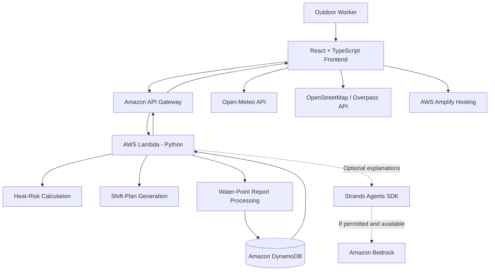

# ShiftCool 🌤️

### Heat-Safety Intelligence & Drinking-Water Assistance for Outdoor Workers

**Environmental Hacks Hackathon | Track 2: Heat and Water**

ShiftCool is a heat-safety and drinking-water assistance platform designed for people who work outdoors in hot conditions. It combines hourly weather forecasts, transparent heat-risk screening, shift-planning guidance, and mapped public drinking-water points in one integrated workflow.

Our goal is simple: **help outdoor workers make better-informed decisions about heat exposure and find drinking water when they need it.**

---

## The Problem

Millions of people work outdoors in environments where heat exposure can become dangerous. Construction workers, delivery partners, traffic police officers, sanitation workers, and other outdoor workers may face prolonged heat exposure while having limited access to reliable information about nearby drinking-water facilities.

Two challenges often occur together:

- **Heat exposure:** Workers may lack accessible, location-specific information about changing weather conditions throughout their shifts.
- **Water accessibility:** Public drinking-water points may be difficult to locate, and mapped facilities are not necessarily functional, accessible, or recently verified.

Existing weather applications provide forecasts, but a forecast alone does not turn into a practical shift plan. Similarly, a map pin does not guarantee that a drinking-water point is working.

ShiftCool connects these problems through a single, practical workflow.

## Our Solution

ShiftCool helps users assess upcoming heat conditions, plan their shifts more thoughtfully, and discover nearby public drinking-water points with transparent status information.

### Core Features

**1. Location-Based Heat Screening**

- Retrieve hourly weather forecasts for a selected location.
- Process available weather variables into documented heat-risk indicators.
- Present hourly conditions and explain the limitations of the calculation.

**2. Shift Planning**

- Analyse the user's selected shift window.
- Highlight potentially lower-risk periods where supported by the available data.
- Provide precautionary guidance on rest, hydration, and following workplace heat-safety procedures.
- Clearly distinguish decision-support recommendations from guarantees of safety.

**3. Public Drinking-Water Map**

- Discover mapped drinking-water points using OpenStreetMap data.
- Display available descriptions, locations, distances, and report freshness.
- Distinguish mapped locations from recently reported or corroborated locations.

**4. Community-Powered Status Reports**
Users can report a water point as:

- **Working**
- **Dry / not working**
- **Unable to verify**

Reports are stored by the backend and used to update the water-point information shown to subsequent users.

**5. Transparent Trust and Freshness**

- Display the time of the latest report.
- Account for report recency and agreement when presenting confidence.
- Avoid treating a single unverified report as definitive proof that a facility works or does not work.

**6. AI-Assisted Explanations — Planned**
Where available and permitted, an AI agent built with Strands Agents SDK and Amazon Bedrock may explain calculated risk indicators and summarise a shift plan. Numerical calculations and safety rules remain in deterministic application code.

---

## How It Works

1. **Choose a work location:** Select a location, shift start and end times, and optionally the type or intensity of work.
2. **Retrieve the forecast:** Fetch hourly weather data from Open-Meteo.
3. **Calculate heat indicators:** Process available data using a documented method and display its limitations.
4. **Generate a shift plan:** Present precautionary recommendations based on the calculated indicators and selected shift.
5. **Find drinking water:** Explore nearby mapped public drinking-water points.
6. **Report a status:** Submit a report about a facility's current condition.
7. **Update the map:** Save the report through the AWS backend and reflect the latest available status.

### The Main Demonstration

A worker checks the heat conditions for an upcoming shift, receives precautionary guidance, finds a nearby drinking-water point, reports that it is unavailable, and sees the updated status in the application.

This end-to-end interaction is the central feature of ShiftCool.

---

## System Architecture



### AWS Services

| Service                 | Purpose                                                                        |
| ----------------------- | ------------------------------------------------------------------------------ |
| **AWS SAM CLI**         | Define, build, test, and deploy the serverless backend.                        |
| **AWS Lambda**          | Execute Python backend logic without managing servers.                         |
| **Amazon API Gateway**  | Expose HTTP endpoints to the frontend.                                         |
| **Amazon DynamoDB**     | Persist water-point reports, timestamps, and status information.               |
| **AWS Amplify Hosting** | Host the React web application.                                                |
| **Amazon S3**           | Optional storage for static datasets or files if needed.                       |
| **Amazon EventBridge**  | Optional scheduled data refreshes in a later phase.                            |
| **Amazon SNS**          | Optional notifications if time and requirements permit.                        |
| **Amazon Bedrock**      | Optional AI-powered explanations, subject to availability and hackathon rules. |

AWS services will be described as integrated only after they have actually been configured and tested.

---

## Technology Stack

### Frontend

- React
- TypeScript
- Vite
- Leaflet for interactive maps

### Backend

- Python
- AWS Lambda
- Amazon API Gateway
- Amazon DynamoDB
- AWS Serverless Application Model (SAM)

### External Data Sources

- **Open-Meteo:** Hourly weather forecast data.
- **OpenStreetMap / Overpass API:** Mapped public drinking-water locations.

### Optional AI Layer

- Strands Agents SDK
- Amazon Bedrock

The application is designed around a lightweight serverless architecture to keep infrastructure management and operational complexity low.

---

## Heat-Safety Methodology

Heat safety is more complex than air temperature alone. Humidity, solar radiation, wind, physical exertion, clothing, acclimatization, and workplace conditions can substantially affect heat stress.

ShiftCool is designed to provide **decision-support information, not a definitive occupational heat-stress assessment**.

Our implementation will:

- Document the selected heat-risk method and its source.
- State which environmental variables are used and which are unavailable.
- Keep numerical calculations and thresholds in deterministic code.
- Clearly identify limitations when direct sunlight, workload, clothing, or other important factors are not measured.
- Encourage appropriate workplace controls, supervision, official warnings, and emergency procedures.

A lower displayed risk indicator must never be interpreted as a guarantee that working conditions are safe. ShiftCool does not replace occupational-health guidance or emergency response.

---

## Water-Point Trust Model

Mapped locations provide a starting point, not proof of current availability.

ShiftCool separates:

- **Mapped:** A drinking-water location exists in the underlying map data.
- **Reported:** A user has submitted a status report.
- **Recently corroborated:** Recent reports provide supporting evidence about the reported status.
- **Unknown or stale:** The available information is insufficient or outdated.

Each point is intended to have a stable identifier, coordinates, available descriptive information, report history or summary, and the timestamp of its latest report.

Confidence will be based on a transparent rule using report freshness, report count, and agreement between reports. The application will avoid presenting uncertain information as verified fact.

---

## Repository Structure

```text
shiftcool/
├── frontend/
│   ├── src/
│   │   ├── components/
│   │   ├── pages/
│   │   ├── services/
│   │   └── types/
│   └── package.json
│
├── backend/
│   ├── template.yaml
│   ├── requirements.txt
│   ├── src/
│   │   ├── app.py
│   │   ├── weather.py
│   │   ├── heat_risk.py
│   │   ├── shift_plan.py
│   │   ├── water_points.py
│   │   └── storage.py
│   └── tests/
│
├── docs/
│   ├── api-contract.md
│   └── heat-methodology.md
│
├── README.md
└── .gitignore
```

The final structure may evolve as implementation progresses.

---

## Local Development

### Prerequisites

- Node.js and npm
- Python 3.12 or a Python version supported by the selected AWS Lambda runtime
- AWS CLI
- AWS SAM CLI
- An AWS account with the necessary permissions for deployment

### 1. Clone the Repository

```bash
git clone <YOUR_REPOSITORY_URL>
cd shiftcool
```

### 2. Run the Frontend

Once the frontend has been configured:

```bash
cd frontend
npm install
npm run dev
```

Vite will print the local development URL in your terminal.

### 3. Set Up the Backend

From the repository root:

```bash
cd backend
python -m venv .venv
```

Activate the virtual environment.

**Windows PowerShell:**

```powershell
.venv\Scripts\Activate.ps1
```

**Linux / macOS:**

```bash
source .venv/bin/activate
```

Install the backend dependencies after `requirements.txt` has been configured:

```bash
python -m pip install -r requirements.txt
```

### 4. Test and Build with SAM

Once the SAM template and Lambda handlers are implemented:

```bash
sam validate
sam build
```

Run the local API after configuring the template and local environment:

```bash
sam local start-api
```

AWS credentials and configuration will be required for deployment and access to deployed AWS resources.

> These commands describe the intended development workflow. They do not imply that the backend has already been built or deployed.

---

## API Design

The planned HTTP API includes:

| Method | Endpoint                     | Purpose                                                  |
| ------ | ---------------------------- | -------------------------------------------------------- |
| `GET`  | `/health`                    | Check backend availability.                              |
| `GET`  | `/weather`                   | Retrieve hourly forecast data for a location.            |
| `POST` | `/shift-plan`                | Generate heat indicators and shift recommendations.      |
| `GET`  | `/water-points`              | Retrieve mapped points and available report information. |
| `POST` | `/water-points/{id}/reports` | Submit a water-point status report.                      |

The exact request and response schemas will be documented in `docs/api-contract.md` and kept consistent between frontend and backend.

---

## Environmental and Social Impact

ShiftCool aims to make heat-safety information and drinking-water availability easier to access for people who work outdoors.

Potential impact indicators include:

- Number of mapped drinking-water points displayed.
- Number and age of recent status reports.
- Distance to the nearest recently corroborated water point.
- Number of shifts for which the system generates a plan.
- Potential work periods identified for additional precautions or adjustment.

These indicators measure system activity and potential usefulness; they do not, by themselves, prove that heat illness has been prevented or that working conditions have improved.

Any demonstration data will be identified as simulated. Measured outcomes will be reported separately from estimates.

---

## Responsible Data Usage

ShiftCool depends on external data providers and community reports.

- Weather forecasts are estimates and may change.
- OpenStreetMap locations may be incomplete, outdated, inaccessible, or incorrectly tagged.
- Overpass API availability and usage policies must be respected.
- Report freshness and uncertainty will be shown where relevant.
- User-submitted reports will be validated before storage.
- API permissions will follow least-privilege principles.
- AWS resource usage and costs will be monitored during development and deployment.

---

## Development Roadmap

- [x] Build the React + TypeScript application.
- [x] Integrate Open-Meteo hourly forecasts.
- [x] Implement and test the documented heat-risk method.
- [x] Generate structured shift-plan recommendations.
- [x] Integrate Leaflet and mapped drinking-water locations.
- [x] Add water-point status reporting.
- [x] Build Python Lambda handlers using AWS SAM.
- [x] Expose API endpoints through API Gateway.
- [x] Persist reports using DynamoDB.
- [x] Test the complete report-to-map update workflow.
- [x] Deploy the backend to AWS.
- [x] Deploy the frontend using Amplify Hosting.
- [x] Evaluate Strands Agents SDK and Bedrock availability.
- [x] Prepare the final demonstration and project documentation.

---

## Why ShiftCool?

Heat safety and access to drinking water are connected everyday needs for outdoor workers. ShiftCool brings weather-based guidance and community-informed water-point information together, with a focus on transparency, practical action, and responsible technology.

**Our principle: help workers make better-informed decisions without pretending that uncertain data can guarantee their safety.**

---

### Built for Environmental Hacks

**Track 2: Heat and Water**

*ShiftCool — Practical heat-safety guidance. Actionable drinking-water information. A connected workflow.*
