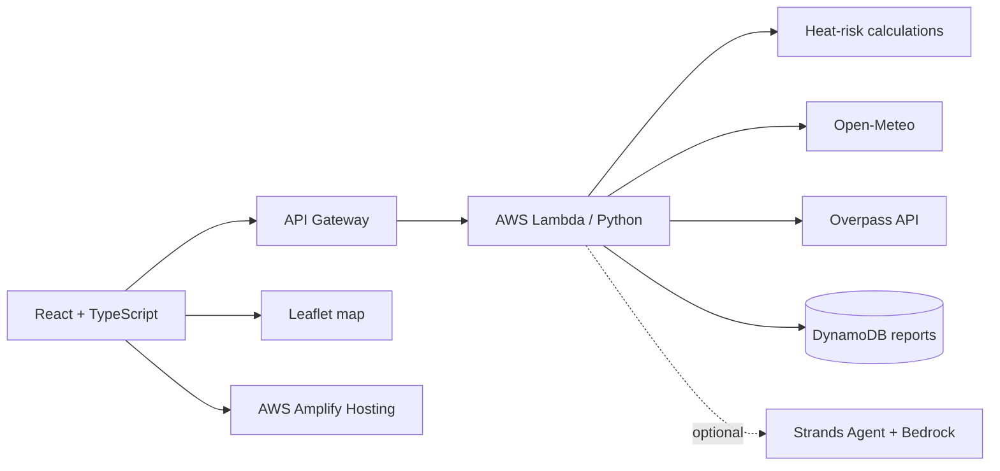

# ShiftCool

**Heat-safety intelligence and drinking-water assistance for outdoor workers.**

ShiftCool combines location-based weather screening, deterministic heat-risk calculations, shift-planning guidance, and nearby drinking-water discovery in one React application. The backend is designed for AWS Lambda and API Gateway, with DynamoDB storing community water-point reports.

> **Safety notice:** ShiftCool is decision-support software, not a medical, occupational-health, or emergency-response system. Its heat indicator is not WBGT and does not guarantee safe working conditions. Follow local guidance, employer procedures, supervisor instructions, and emergency protocols.

## What it does

- Retrieves an hourly forecast from Open-Meteo for the user's location.
- Calculates an apparent-temperature heat-risk indicator in Python.
- Generates structured shift recommendations with deterministic rules.
- Finds mapped drinking-water points using OpenStreetMap/Overpass.
- Lets users report whether a water point is working.
- Stores report timestamps and status history in DynamoDB.
- Optionally explains a generated shift plan with Strands Agents SDK and Amazon Bedrock.
- Falls back to the frontend's demo data when location permission or the backend is unavailable.

## Architecture



### AWS services

| Service | Use |
| --- | --- |
| AWS SAM | Infrastructure definition, local build, validation, and deployment |
| AWS Lambda | Python API handler |
| API Gateway | Public HTTP API |
| DynamoDB | Water-point report storage |
| S3 | Provisioned for future static data or assets |
| Amplify Hosting | Frontend hosting |
| Strands Agents + Bedrock | Optional natural-language explanations |
| EventBridge / SNS | Optional future refreshes and notifications |

## Repository layout

```text
SHIFTCOOL/
├── backend/
│   ├── src/
│   │   ├── app.py              # Lambda routes and external integrations
│   │   ├── heat_risk.py        # Deterministic risk calculations
│   │   └── ai_explanation.py   # Optional Strands/Bedrock explanation
│   ├── tests/
│   ├── requirements.txt
│   └── template.yaml           # SAM resources and API routes
├── frontend/
│   ├── src/
│   │   ├── components/         # Dashboard views
│   │   ├── services/           # API client and frontend helpers
│   │   └── types/              # TypeScript domain types
│   ├── .env.example
│   └── package.json
└── README.md
```

## Prerequisites

- Node.js 18 or newer
- Python 3.12
- AWS CLI configured with credentials
- AWS SAM CLI
- An AWS account with permission to create Lambda, API Gateway, DynamoDB, S3, and IAM resources

## Run the frontend locally

```powershell
cd frontend
npm install
Copy-Item .env.example .env.local
```

Set the API Gateway URL in `frontend/.env.local`:

```env
VITE_API_BASE_URL=https://YOUR_API_ID.execute-api.YOUR_REGION.amazonaws.com/prod
```

Start the Vite development server:

```powershell
npm run dev
```

Open the URL printed by Vite, normally `http://localhost:5173`.

Build the frontend:

```powershell
npm run build
```

The production files are generated in `frontend/dist/`.

## Run and test the backend

Create a virtual environment from the repository root:

```powershell
cd backend
python -m venv .venv
.\.venv\Scripts\Activate.ps1
python -m pip install -r requirements.txt
```

Validate and build with SAM:

```powershell
sam validate
sam build
```

Start the local API:

```powershell
sam local start-api
```

The local API normally runs at `http://127.0.0.1:3000`. To use it from the frontend, set:

```env
VITE_API_BASE_URL=http://127.0.0.1:3000
```

Run backend tests:

```powershell
python -m pytest tests
```

If `pytest` is not installed, install the project's test dependencies first:

```powershell
python -m pip install pytest
```

## Deploy the backend

From `backend/`:

```powershell
sam build
sam deploy --guided
```

The deployment creates the Lambda function, API Gateway routes, DynamoDB table, and S3 bucket defined in `template.yaml`. Save the `ApiUrl` output and use it as `VITE_API_BASE_URL` when building the frontend.

For a later deployment without prompts:

```powershell
sam deploy
```

Do not commit generated SAM configuration files if they contain environment-specific or sensitive values.

## API reference

All successful responses are JSON. Errors use the shape `{ "error": "message" }`.

| Method | Route | Description |
| --- | --- | --- |
| `GET` | `/health` | Returns backend health status |
| `GET` | `/weather?latitude={lat}&longitude={lon}` | Returns two days of hourly weather and risk records |
| `POST` | `/shift-plan` | Generates recommendations from an `hourly_risk` array |
| `POST` | `/explain` | Optionally explains a generated plan |
| `GET` | `/water-points?latitude={lat}&longitude={lon}&radius_m={meters}` | Finds mapped drinking-water points |
| `POST` | `/water-points/{point_id}/reports` | Stores a community status report |

### Generate a shift plan

```json
{
  "hourly_risk": [
    {
      "time": "2026-10-10T12:00",
      "temperature_c": 36.2,
      "relative_humidity": 58,
      "wind_speed_kmh": 11,
      "apparent_temperature_c": 41.0,
      "risk_level": "very_high"
    }
  ]
}
```

### Submit a water-point report

```json
{
  "status": "Working"
}
```

Allowed statuses are `Working`, `Dry / not working`, and `Unable to verify`.

## Heat-risk methodology

The backend uses a transparent apparent-temperature approximation:

```text
apparent temperature =
  air temperature + humidity factor × max(0, air temperature - 14°C) × 0.35
```

Risk bands are:

| Apparent temperature | Risk |
| ---: | --- |
| `< 27°C` | Lower |
| `27–31.9°C` | Moderate |
| `32–40.9°C` | High |
| `≥ 41°C` | Very high |

The calculation does not model direct solar radiation, clothing, exertion, acclimatization, shade, medical factors, or workplace controls. Numeric calculations remain in `backend/src/heat_risk.py`; the optional AI layer only explains already-calculated results.

## Optional AI explanations

AI explanations are disabled by default. To enable them in the deployed Lambda environment, configure:

```text
ENABLE_AI_EXPLANATION=true
BEDROCK_MODEL_ID=amazon.nova-lite-v1:0
```

This requires the Strands SDK in the Lambda package and permission to invoke the selected Bedrock model in the deployment region. Enable it only when permitted by the hackathon rules and after verifying AWS costs and regional availability.

## Data and responsible use

- Open-Meteo forecasts are estimates and can change.
- OpenStreetMap data may be incomplete, stale, inaccessible, or incorrectly tagged.
- A mapped water point is not proof that the point is currently usable.
- Community reports are displayed with status, freshness, count, and confidence information.
- Overpass API usage must follow its service policy and rate limits.
- Keep AWS IAM permissions least-privilege and monitor resource costs.
- Never treat a lower risk indicator as a guarantee of safety.

## Current status

- [x] React + TypeScript dashboard
- [x] Frontend API client and backend integration
- [x] SAM template with Lambda, API Gateway, DynamoDB, and S3
- [x] Deterministic heat-risk and shift-plan logic
- [x] Open-Meteo weather integration
- [x] Overpass water-point integration
- [x] Community water-point reporting
- [ ] Production AWS deployment
- [ ] Amplify Hosting deployment
- [ ] Optional Strands/Bedrock explanation deployment

## License

See [LICENSE](LICENSE).
