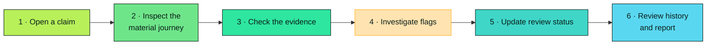
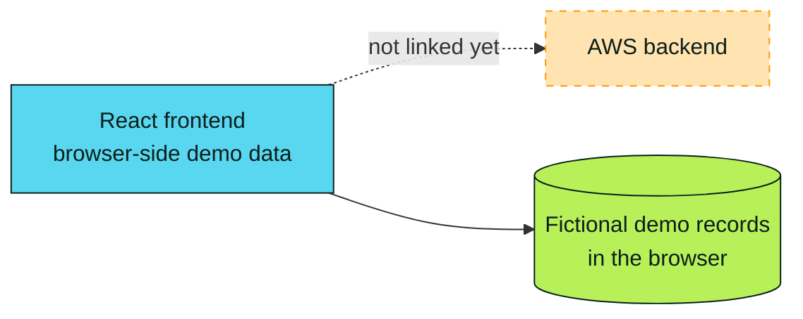
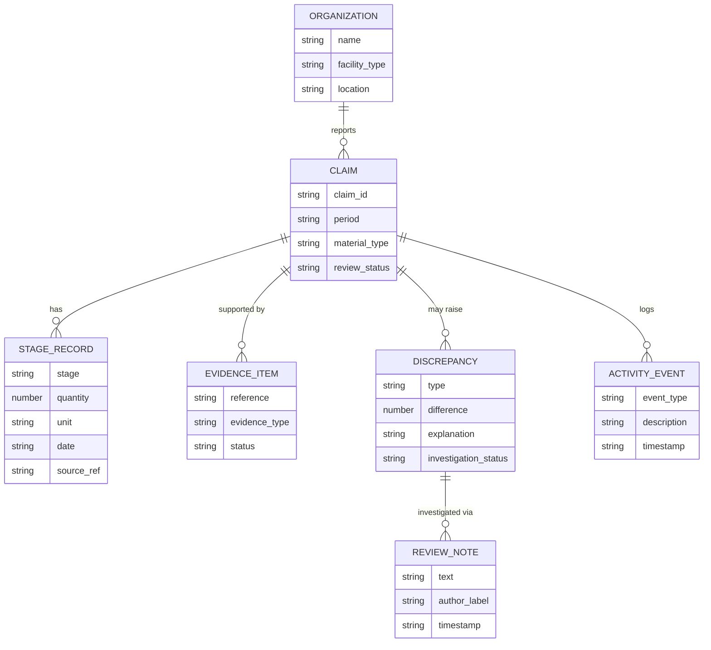

<div align="center">


<br>


<br>


<br>


<br><br>

**[🌍 Overview](#-overview)** &nbsp;•&nbsp;
**[✨ Features](#-key-features)** &nbsp;•&nbsp;
**[🔄 Workflow](#-how-the-workflow-works)** &nbsp;•&nbsp;
**[🚀 Get started](#-getting-started)** &nbsp;•&nbsp;
**[📐 Data model](#-data-model-and-reconciliation-principles)** &nbsp;•&nbsp;
**[🛣️ Roadmap](#%EF%B8%8F-roadmap)**

</div>

<br>

> [!IMPORTANT]
> **Hackathon prototype.** CycleProof highlights records that need attention. A mismatch is not, by itself, proof of fraud, proof of environmental harm, or proof that a claim is false. Human review and reliable source evidence remain essential.

<details>
<summary><b>📑 Table of contents</b></summary>

<br>

- [Overview](#-overview)
- [The problem](#-the-problem)
- [Our approach](#-our-approach)
- [Key features](#-key-features)
- [How the workflow works](#-how-the-workflow-works)
- [Example scenario](#-example-scenario)
- [Technology stack](#-technology-stack)
- [Getting started](#-getting-started)
- [Available scripts](#-available-scripts)
- [Project structure](#%EF%B8%8F-project-structure)
- [Data model and reconciliation principles](#-data-model-and-reconciliation-principles)
- [Frontend-only scope](#%EF%B8%8F-frontend-only-scope)
- [Privacy and demo data](#-privacy-and-demo-data)
- [Current status](#-current-status)
- [Roadmap](#%EF%B8%8F-roadmap)
- [Contributing](#-contributing)
- [Disclaimer](#%EF%B8%8F-disclaimer)

</details>


## 🌍 Overview

CycleProof is a prototype for reviewing environmental claims in the electronic-waste (e-waste) recycling chain. It helps reviewers compare reported material quantities with available records, see where evidence is missing, and investigate inconsistencies across the lifecycle of a material.

A recycling claim may refer to material **collected, received at a facility, processed, recovered, or dispatched** to another destination. Those figures may be recorded by different organizations and in different files. CycleProof brings the information into one review experience so that gaps are easier to see and explain.

<div align="center">
  
</div>

<br>

> [!NOTE]
> Built for **AWS Environmental Hacks by WeMakeDevs**. The current focus is the frontend experience. The project also includes an AWS backend, which is **not linked to the frontend yet**; integration is out of scope until separately authorized.

## 🔎 The problem

Environmental and recycling claims are hard to evaluate when supporting records are fragmented across spreadsheets, documents, organizations, and facilities. Reviewers may need to compare quantities and identifiers by hand to answer questions like these:

| | Question a reviewer faces |
| :-: | --- |
| 🔗 | Does the quantity reported as **collected** match the records **received** by the next facility? |
| 📎 | Is there documentation to support a reported **recovery** quantity? |
| 🧬 | Are any records **duplicated** or inconsistent? |
| 📉 | At which **stage** does a material quantity stop reconciling? |
| 🚧 | Which claims have **unresolved evidence gaps**? |
| 🕒 | What **changed** during the review, and why was a decision made? |

Manual reconciliation makes these issues slow to find and hard to explain. CycleProof gives reviewers a clearer place to inspect the records and document the review.

## 💡 Our approach

The review is organized around three connected concepts.

<table>
<tr>
<td width="33%" valign="top">

### 🏷️ Claims
What an organization **reports**.

</td>
<td width="33%" valign="top">

### 📎 Evidence and records
The documents and entries **available to support** the report.

</td>
<td width="33%" valign="top">

### ⚖️ Reconciliation and review
Comparisons that **identify differences** and help a reviewer investigate them.

</td>
</tr>
</table>

The interface makes clear which values were compared, which evidence is available, what is missing, and what remains unresolved. It should never turn a mathematical mismatch into an unsupported accusation.


## ✨ Key features

> [!NOTE]
> This describes the **intended** CycleProof experience. Individual features may still be in development; see [Current status](#-current-status).

| | Feature | What it does |
| :-: | --- | --- |
| 📊 | **Dashboard** | Summarizes claims awaiting review, open discrepancies, missing evidence, and recent activity, using the same dataset as the detailed screens |
| 🔍 | **Claims explorer** | Search, filter, sort, and open claims, showing organization, period, quantities, evidence coverage, status, and outstanding issues |
| 📄 | **Claim details** | A central review page that brings together quantity comparisons, evidence references, discrepancies, notes, and history |
| 🛤️ | **Material journey** | Shows the flow Collected → Received → Processed → Recovered → Dispatched and where records stop reconciling |
| ⚖️ | **Discrepancy explorer** | A workspace for flagged issues, with the comparison behind each flag and a way to record investigation status |
| 📎 | **Evidence management** | Inspect evidence references and, in the prototype, import CSV files locally for validation, column mapping, and preview |
| 🕒 | **Activity timeline** | Evidence additions, quantity edits, notes, discrepancy updates, and status changes in order |
| 🏭 | **Organizations and facilities** | Profiles for fictional collection centers, recyclers, processing, recovery, and dispatch sites, linked to their claims |
| 🔔 | **Notifications** | Demo alerts for new discrepancies, evidence gaps, and pending reviews |
| 📈 | **Analytics and reporting** | Summaries of reconciliation results, evidence completeness, and discrepancy patterns, labelled with scope and generation time |
| ⚙️ | **Settings and guided demo** | Browser-side preferences and a walkthrough for first-time users |

<details>
<summary><b>🛤️ &nbsp;More on the material journey and the discrepancy explorer</b></summary>

<br>

**Material journey.** Reviewers can inspect the values available at each stage and see where records no longer reconcile. **Missing information is shown as missing, never silently treated as zero.**

**Discrepancy explorer.** Flags cover quantity mismatches, missing evidence, suspected duplicate entries, and inconsistent identifiers or dates. Each flag should explain the comparison that triggered it.

**Activity timeline.** A local demo timeline illustrates review history, but it is **not a tamper-proof audit log**.

**Evidence management.** The frontend-only version does not upload imported files to a server.

</details>

## 🔄 How the workflow works



1. **Open a claim.** Review the organization, reporting period, and claimed material quantities.
2. **Inspect the material journey.** Compare quantities across collection, receipt, processing, recovery, and dispatch where records are available.
3. **Check the evidence.** Inspect supporting document references and identify missing or incomplete records.
4. **Investigate flags.** Review the values and rules behind a discrepancy, then add notes or request more information.
5. **Update the review status.** Record whether the issue is open, under review, needs more information, or resolved.
6. **Review the history and report.** Inspect the recorded demo activity and export or print a summary when that functionality is available.

## 🧪 Example scenario

Imagine a **fictional** recycler reports that it recovered **820 kg** of a particular material. The available processing record accounts for **790 kg**.

| Source | Quantity | |
| --- | ---: | --- |
| Reported recovery | **820 kg** | claim |
| Processing record | **790 kg** | record |
| Difference | **30 kg** | 🟧 flagged for investigation |

CycleProof could flag the 30 kg difference, show the records used in the comparison, and indicate whether supporting evidence is missing. A reviewer could add a note and mark the issue as **under review**.

> [!WARNING]
> This flag would not establish *why* the difference exists. It could reflect timing, measurement methods, a recording error, incomplete records, or another explanation. The reviewer must investigate before drawing a conclusion.


## 🧰 Technology stack


| Layer | Technology | Role |
| --- | --- | --- |
| **UI** | React | Component-based user interface |
| **Language** | TypeScript | Typed application code |
| **Tooling** | Vite | Local dev server and production build |
| **Styling** | CSS | Application styling |
| **Maps** | Leaflet | In the current dependency set; use only where a map is relevant |
| **Backend** | AWS | Exists in the project, **not yet linked** to the frontend |

Exact installed versions and scripts are defined in `frontend/package.json` and `frontend/package-lock.json`.



## 🚀 Getting started

<details open>
<summary><b>1 · Prerequisites</b></summary>

<br>

- **Node.js 18** or newer
- **npm** (included with Node.js)

```bash
node --version
npm --version
```

</details>

<details open>
<summary><b>2 · Get the source code</b></summary>

<br>

```bash
git clone <YOUR_REPOSITORY_URL>
cd <YOUR_REPOSITORY_DIRECTORY>
```

Or download and extract the project ZIP, then open a terminal in the extracted directory. Replace the placeholders with the real repository URL and directory name.

</details>

<details open>
<summary><b>3 · Install and run the frontend</b></summary>

<br>

```bash
cd frontend
npm install
npm run dev
```

Vite prints a local URL, commonly **`http://localhost:5173`**. Open it in your browser.

> [!TIP]
> Run these commands from the directory that contains the frontend's `package.json`. If your copy has it at the repository root, run them from there instead.

</details>

<details>
<summary><b>4 · Build and preview a production bundle</b></summary>

<br>

```bash
npm run build      # type-check and create a production bundle
npm run preview    # serve the production build locally
```

Resolve any reported TypeScript errors before treating the build as successful. Use the local URL printed by Vite to inspect the build.

</details>

### 📜 Available scripts

Run from the `frontend` directory.

| Command | Purpose |
| --- | --- |
| `npm install` | Install project dependencies |
| `npm run dev` | Start the Vite development server |
| `npm run build` | Run the configured TypeScript checks and create a production bundle |
| `npm run preview` | Serve the production build locally |

> No backend, database, AWS credentials, or cloud deployment is required for the intended frontend-only demo.

## 🗂️ Project structure

The layout can evolve as the application is adapted from its original project. The frontend currently follows a React and TypeScript structure similar to this:

<details>
<summary><b>Expand the tree</b></summary>

<br>

```text
CycleProof/
├── README.md
├── backend/               # AWS backend (not yet linked to the frontend)
└── frontend/
    ├── package.json
    ├── package-lock.json
    ├── index.html
    ├── vite.config.ts
    ├── tsconfig.json
    └── src/
        ├── main.tsx       # React entry point
        ├── App.tsx        # Main application composition and top-level UI
        ├── index.css      # Global styles and shared design rules
        ├── components/    # Reusable UI components
        ├── services/      # Client-side helpers and demo-data logic
        ├── types/         # TypeScript types and interfaces
        └── lib/           # Small reusable utilities and hooks
```

Use the actual source tree as the source of truth if file names differ in your checkout, and avoid creating duplicate versions of existing components or styles.

</details>


## 📐 Data model and reconciliation principles

Related entities should be represented consistently rather than hardcoding separate numbers in each screen.



<details>
<summary><b>🧩 &nbsp;Conceptual entities in detail</b></summary>

<br>

| Entity | Typical fields |
| --- | --- |
| **Claim** | claim ID, organization, reporting period, material type, claimed quantities, review status |
| **Organization or facility** | ID, name, facility type, location, related claims |
| **Material-stage record** | claim ID, stage, quantity, unit, date, source record reference |
| **Evidence item** | document name or reference, evidence type, related claim or stage, availability and status |
| **Discrepancy** | type, compared values, calculated difference, optional configured tolerance, explanation, investigation status |
| **Review note** | claim or discrepancy reference, note text, author label, timestamp |
| **Activity event** | related record, event type, description, timestamp |
| **Notification** | message, related record, timestamp, read or unread state |

These are conceptual entities, not a promise that every field or screen is already implemented.

</details>

### ⚖️ Reconciliation rules

| | Rule |
| :-: | --- |
| 📏 | Compare quantities only when their **units and context** are compatible |
| 👁️ | Keep the **source values visible** next to calculated differences |
| 🧮 | Show the **formula or explanation** behind a flag |
| 🕳️ | **Never assume** that missing data means zero |
| ➗ | Avoid percentages when the denominator is zero or unavailable |
| 🎚️ | Treat tolerances as **explicit, configurable demo rules**, not universal regulatory standards |
| 🤖 | Distinguish **automated flags** from **human review outcomes** |
| 🔖 | Preserve the **source of each value** where the data model supports it |

## 🖥️ Frontend-only scope

The current phase focuses on a working browser experience with mock data and local interactions.

<table>
<tr>
<td width="50%" valign="top">

### ✅ Included, where implemented
- React-based interface and navigation
- Fictional demo claims and organizations
- Browser-side calculations and state changes
- Local CSV validation and preview
- Local preference or demo-state persistence
- Client-side report generation or print workflows

</td>
<td width="50%" valign="top">

### 🚫 Not included in this phase
- Integration with the AWS backend (for example Lambda, API Gateway, DynamoDB, or S3)
- A backend server or hosted database wired to the UI
- Real authentication or role-based authorization
- Server-side file uploads or cloud evidence storage
- Connection to official recycler records or external verification
- Legally binding certification or automated fraud determinations

</td>
</tr>
</table>

The code should stay organized so the backend can be connected later, but **backend integration must not be assumed to exist** in the frontend.

## 🔐 Privacy and demo data

> [!CAUTION]
> Do not enter confidential business records, personal information, or sensitive operational data into a demo build.

- 🧪 Sample claims, organizations, evidence references, and quantities should be **fictional** and clearly identified as demo data.
- 💾 Browser storage is **not a secure database** and should not be treated as one.
- 📄 CSV import in the frontend-only phase is for **local parsing, validation, and preview**, not server upload.
- 🔄 Resetting the demo should restore a consistent sample state where that feature is implemented.

## 📍 Current status

CycleProof is a hackathon prototype under development. The existing React and TypeScript frontend is the starting point for the CycleProof experience, and the intended feature set covers claims review, material-flow visualization, evidence handling, discrepancy investigation, organization profiles, activity history, notifications, analytics, settings, and reporting.

> [!WARNING]
> Do not assume every planned feature is complete or connected to production data. Confirm what works in the current code and test the application locally.

## 🛣️ Roadmap

> [!NOTE]
> These are planned possibilities, not claims that the functionality already exists.

- [ ] Complete and test all frontend screens and interactions
- [ ] Improve consistency of shared mock data across dashboards, claims, analytics, and reports
- [ ] Add automated tests for quantity calculations, CSV validation, and report generation
- [ ] Conduct usability and accessibility checks
- [ ] Define reconciliation rules with relevant recycling and compliance experts
- [ ] Connect the frontend to the existing AWS backend
- [ ] Integrate secure document storage and reliable source references
- [ ] Add authentication, authorization, and audit controls before handling real operational data
- [ ] Evaluate the workflow with people who do recycling, environmental reporting, or compliance reviews

## 🤝 Contributing

If you are working on the prototype:

1. **Inspect** the existing components and styles before adding replacements.
2. **Reuse** the project's design system and existing patterns.
3. **Keep related screens connected** to the same underlying data.
4. **Avoid adding backend or AWS dependencies** to the frontend during this phase.
5. **Make controls work.** Every control should perform its stated action and give useful feedback.
6. **Test locally.**

Before submitting a change, run this from the `frontend` directory:

```bash
npm run build
```

Document any remaining build failures or incomplete functionality instead of claiming the project is fully tested.

## ⚖️ Disclaimer

CycleProof is an early-stage prototype intended to support the review of environmental claims. It is not a regulatory certification system, legal determination, or substitute for an independent audit. Discrepancies indicate that information may need further investigation; they do not establish intent, fraud, or environmental impact. Any demo data is illustrative unless explicitly replaced with independently verified records.

<br>

<div align="center">

**CycleProof: follow the material, investigate the gaps, support transparent reporting.**

<sub>Built for **AWS Environmental Hacks by WeMakeDevs** ♻️</sub>

<br><br>


</div>
