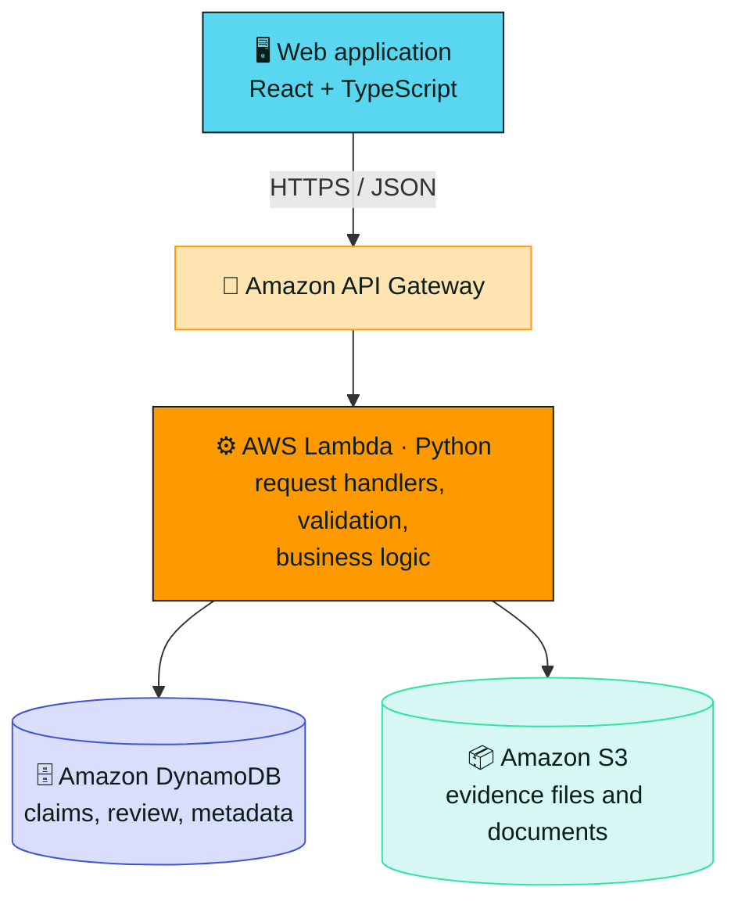
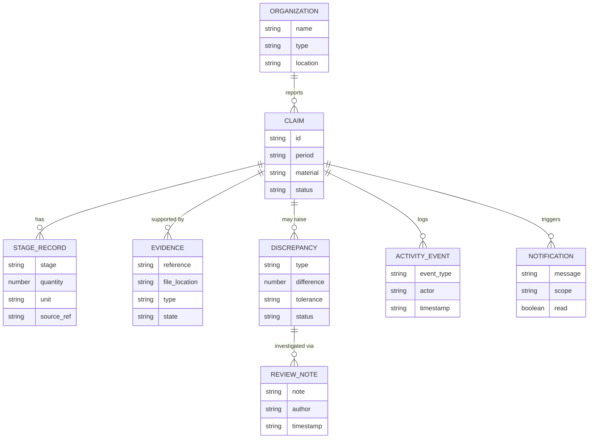

<div align="center">


<br>


<br>


<br>


<br><br>

**[🌍 Overview](#-overview)** &nbsp;•&nbsp;
**[✨ Features](#-features)** &nbsp;•&nbsp;
**[🏗️ Architecture](#%EF%B8%8F-system-architecture)** &nbsp;•&nbsp;
**[🚀 Get started](#-getting-started)** &nbsp;•&nbsp;
**[☁️ Deploy](#%EF%B8%8F-aws-deployment)** &nbsp;•&nbsp;
**[🔌 API](#-api-overview)** &nbsp;•&nbsp;
**[🔐 Security](#-security-and-privacy)**

</div>

<br>

> [!IMPORTANT]
> A discrepancy is a **signal for investigation, not proof of fraud**. CycleProof supports evidence-based human review. It does not automatically establish that an environmental claim is true or false.

<details>
<summary><b>📑 Table of contents</b></summary>

<br>

- [Overview](#-overview)
- [The problem](#-the-problem)
- [The solution](#-the-solution)
- [Features](#-features)
- [How it works](#-how-it-works)
- [System architecture](#%EF%B8%8F-system-architecture)
- [Technology stack](#-technology-stack)
- [Project structure](#%EF%B8%8F-project-structure)
- [Getting started](#-getting-started)
- [Environment configuration](#%EF%B8%8F-environment-configuration)
- [Running locally](#-running-locally)
- [AWS deployment](#%EF%B8%8F-aws-deployment)
- [API overview](#-api-overview)
- [Data model](#-data-model)
- [Security and privacy](#-security-and-privacy)
- [Testing](#-testing)
- [Troubleshooting](#%EF%B8%8F-troubleshooting)
- [Roadmap](#%EF%B8%8F-roadmap)
- [Contributing](#-contributing)
- [Disclaimer](#%EF%B8%8F-disclaimer)

</details>


## 🌍 Overview

CycleProof is a **full-stack environmental claim reconciliation platform** for the electronic-waste (e-waste) recycling chain. It helps organizations and reviewers compare reported material quantities with operational records, inspect supporting evidence, identify missing documentation, and investigate inconsistencies across the material lifecycle.

A recycling claim may describe material **collected, received at a facility, processed, recovered, or dispatched**. Those records can be produced by different organizations and stored in different formats. CycleProof brings claims, evidence, material-flow records, discrepancy findings, and review history into one unified workflow.

<div align="center">
  
</div>

<br>

The application combines a **web frontend** with a **cloud backend**. The frontend provides dashboards and review tools. The backend exposes APIs, stores application records, and manages evidence files using AWS services.

## 🎯 The problem

Environmental and recycling claims are hard to evaluate when supporting records are fragmented across spreadsheets, documents, organizations, and facilities. Reviewers may have to compare multiple quantities and references by hand to determine:

| | Question |
| :-: | --- |
| ⚖️ | Whether reported quantities **align** across the recycling chain |
| 📎 | Whether the **evidence** needed to support a claim is present |
| 🕳️ | Where an **unexplained difference** appears |
| 🧬 | Whether records contain **duplicate or inconsistent** information |
| 📋 | Which claims **need review**, and what actions have already been taken |

That process is slow and hard to audit when records and explanations are scattered.

## 💡 The solution

CycleProof organizes the process around three connected concepts.

<table>
<tr>
<td width="33%" valign="top">

### 🏷️ Claims
Reported environmental or material-handling **quantities**.

</td>
<td width="33%" valign="top">

### 📎 Evidence and records
The **documents and operational records** used to support those claims.

</td>
<td width="33%" valign="top">

### ⚖️ Reconciliation and review
**Comparisons** that surface inconsistencies and help reviewers document their conclusions.

</td>
</tr>
</table>

The system keeps the relationships between claims, organizations, material stages, evidence, discrepancies, and review events, so a user can investigate an issue without losing the context behind it.


## ✨ Features

| | Feature | What it does |
| :-: | --- | --- |
| 📊 | **Dashboard** | Claims, pending reviews, evidence gaps, open discrepancies, and recent activity in one view |
| 🔍 | **Claims explorer** | Search, filter, sort, and inspect claims by organization, material, period, review status, and more |
| 📄 | **Claim details** | A full workspace: reported quantities, evidence, reconciliation results, discrepancies, notes, and history |
| 🛤️ | **Material journey** | Follow Collected → Received → Processed → Recovered → Dispatched and see where information stops reconciling |
| ⚖️ | **Discrepancy explorer** | Quantity mismatches, missing evidence, possible duplicates, and inconsistent dates or identifiers, each with its comparison, explanation, status, and source records |
| 📎 | **Evidence management** | Upload and manage supporting documents, link them to claims or stages, and import structured CSV records with validation and preview |
| 🏭 | **Organizations and facilities** | Profiles for collection centers, recyclers, processing, recovery, and dispatch sites, with their claims and review history |
| 🕒 | **Activity timeline** | Evidence changes, quantity updates, review notes, and status transitions in order |
| 🔔 | **Notifications** | Review tasks, new discrepancies, missing evidence, and other items needing attention |
| 📈 | **Analytics and reporting** | Reconciliation outcomes, quantities, evidence completeness, and discrepancy trends, with claim-level and filtered reports |
| ⚙️ | **Settings and onboarding** | Preferences, reconciliation thresholds where authorized, and a walkthrough of the review workflow |
| 🧑‍⚖️ | **Human-centered review** | Reviewers add explanations, request information, update statuses, and record outcomes. Automated flags stay separate from human decisions |

> [!NOTE]
> Production audit guarantees for the activity timeline depend on the deployed implementation and configuration.

## 🔄 How it works

```mermaid
flowchart LR
    A[1 · Create or<br/>import a claim] --> B[2 · Attach records<br/>and evidence]
    B --> C[3 · Reconcile<br/>quantities]
    C --> D[4 · Investigate<br/>flagged differences]
    D --> E[5 · Record a<br/>review outcome]
    E --> F[6 · Track<br/>the history]
    F --> G[7 · Generate<br/>a report]

    style A fill:#b8f05a,stroke:#0b1f1a,color:#0b1f1a
    style B fill:#8fe97b,stroke:#0b1f1a,color:#0b1f1a
    style C fill:#2ee6a0,stroke:#0b1f1a,color:#0b1f1a
    style D fill:#ffe3b0,stroke:#ffb020,color:#0b1f1a
    style E fill:#3fd6c8,stroke:#0b1f1a,color:#0b1f1a
    style F fill:#5ad7f0,stroke:#0b1f1a,color:#0b1f1a
    style G fill:#9dbcff,stroke:#0b1f1a,color:#0b1f1a
```



1. **Create or import a claim.** Capture the organization, reporting period, material, and claimed quantities.
2. **Attach records and evidence.** Associate operational records and documents with the claim and the relevant material stages.
3. **Reconcile available quantities.** Compare compatible values across the material journey using configured rules.
4. **Investigate flagged differences.** Review the values, source records, missing evidence, and explanation for each finding.
5. **Record a review outcome.** Add notes, request more information, or update the discrepancy and claim status.
6. **Track the history.** Inspect relevant activity and notification records.
7. **Generate a report.** Export or print a summary of the claim, reconciliation, evidence, and review outcome.

## 🏗️ System architecture

CycleProof uses a client-server architecture. The browser application talks to an API, and backend functions validate requests and interact with persistent storage.



> [!NOTE]
> This diagram describes the intended deployed architecture. Actual resources, routes, IAM permissions, table keys, and storage policies should match the infrastructure configuration in the repository.

<details>
<summary><b>🧩 &nbsp;Component responsibilities</b></summary>

<br>

| Component | Responsibility |
| --- | --- |
| **Frontend** | Navigation, dashboards, data entry, evidence review, visualizations, and reports |
| **Amazon API Gateway** | HTTPS API entry point for frontend requests |
| **AWS Lambda** | Python handlers for request validation, reconciliation logic, and application operations |
| **Amazon DynamoDB** | Persistent structured application data |
| **Amazon S3** | Evidence file storage, with access controlled by the backend and AWS permissions |

</details>


## 🧰 Technology stack


<table>
<tr>
<td width="33%" valign="top">

### 🖥️ Frontend
- React
- TypeScript
- Vite
- CSS and reusable UI components

</td>
<td width="33%" valign="top">

### ☁️ Backend
- Python
- AWS Lambda
- Amazon API Gateway
- Amazon DynamoDB
- Amazon S3
- AWS SAM for infrastructure definition and deployment

</td>
<td width="33%" valign="top">

### 🛠️ Dev and testing
- Node.js and npm
- Python and pip
- AWS SAM CLI
- Docker, where the local SAM build needs it
- Git

</td>
</tr>
</table>

Refer to the repository manifests and the SAM template for exact dependency versions and configured resources.

## 🗂️ Project structure

The repository contains a frontend application and an AWS SAM backend. Adapt this illustration to the actual layout.

<details>
<summary><b>Expand the tree</b></summary>

<br>

```text
CycleProof/
├── README.md
├── frontend/
│   ├── package.json
│   ├── package-lock.json
│   ├── vite.config.ts
│   └── src/
│       ├── components/
│       ├── services/
│       ├── types/
│       ├── App.tsx
│       └── main.tsx
└── backend/
    ├── template.yaml
    ├── requirements.txt
    ├── src/
    │   └── handlers/
    └── tests/
```

File names and handler locations may differ. Use the actual repository files as the source of truth.

</details>

## 🚀 Getting started

<details open>
<summary><b>1 · Prerequisites</b></summary>

<br>

- **Node.js 18** or newer, and npm
- A **Python** version supported by the Lambda runtime configured in the SAM template
- **AWS SAM CLI**
- **Docker**, if your SAM build configuration requires it
- **AWS CLI**, for deployment
- An **AWS account** and credentials with permissions appropriate to the resources being deployed

```bash
node --version
npm --version
python --version
sam --version
aws --version
docker --version
```

A tool is only required for the commands that use it. Docker is not necessary for every SAM workflow.

</details>

<details open>
<summary><b>2 · Get the source code</b></summary>

<br>

```bash
git clone <YOUR_REPOSITORY_URL>
cd <YOUR_REPOSITORY_DIRECTORY>
```

Replace the placeholders with your repository URL and directory.

</details>

## ⚙️ Environment configuration

The frontend needs the base URL of the deployed or locally running API. Use the variable name the application already expects. For a Vite frontend, a common convention is:

```bash
VITE_API_BASE_URL=http://127.0.0.1:3000
```

For a deployed environment, set it to the API Gateway URL from the deployment outputs. The URL above is illustrative, since the actual local API URL depends on the configured SAM template.

The backend should get resource names and runtime configuration from environment variables or the SAM template. Typical settings:

- DynamoDB table names
- S3 evidence bucket name
- Application environment
- Logging level
- Any explicitly configured reconciliation thresholds

> [!CAUTION]
> Do not commit secrets, AWS access keys, credentials, private evidence, or production environment files. Prefer IAM roles and managed secret storage. Never put secrets in `VITE_*` variables, because they are bundled into client-side code.

## 💻 Running locally

<details open>
<summary><b>🖥️ &nbsp;Frontend</b></summary>

<br>

```bash
cd frontend
npm install
npm run dev        # start the dev server
npm run build      # type-check and create a production bundle
```

Open the local URL printed by Vite in the terminal.

</details>

<details open>
<summary><b>☁️ &nbsp;Backend</b></summary>

<br>

Open a separate terminal at the directory containing `template.yaml`:

```bash
cd backend
sam validate
sam build
sam local start-api   # if the template defines a local API via API Gateway events
```

SAM prints the local endpoint. Point the frontend's API base URL at the endpoint and port your environment uses.

> [!NOTE]
> Local functions may still need valid resource configuration or test data. Local execution does not create or populate cloud resources automatically.

</details>

## ☁️ AWS deployment

> [!WARNING]
> Deploying creates or updates cloud resources and may incur AWS charges. Review the template, permissions, region, and expected costs before proceeding.

<details>
<summary><b>1 · Configure AWS credentials</b></summary>

<br>

Configure a suitable AWS CLI profile using your organization's approved method, then verify the identity and region before deploying.

```bash
aws sts get-caller-identity
aws configure list
```

Avoid pasting access keys into source code or README files.

</details>

<details>
<summary><b>2 · Validate and build</b></summary>

<br>

From the `backend` directory:

```bash
sam validate
sam build
```

Resolve template and build errors before deploying.

</details>

<details>
<summary><b>3 · Deploy</b></summary>

<br>

First-time guided deployment:

```bash
sam deploy --guided
```

Follow the prompts for stack name, AWS Region, deployment permissions, and template parameters. Review the generated configuration file before committing it, especially if it holds environment-specific information.

For later deployments, if the saved configuration is appropriate:

```bash
sam deploy
```

</details>

<details>
<summary><b>4 · Configure the frontend</b></summary>

<br>

Copy the API base URL from the deployment outputs or the API Gateway console, set the frontend environment variable to it, and rebuild:

```bash
npm run build
```

Deploy the resulting static frontend with the hosting approach chosen for the project. Static hosting is a separate step unless the SAM template explicitly defines it.

</details>

<details>
<summary><b>5 · Verify the deployment</b></summary>

<br>

Test the deployed API and frontend with **non-sensitive sample data**, and confirm that:

- [ ] API routes return the expected status codes and response formats
- [ ] Lambda functions can access only the resources they need
- [ ] DynamoDB operations persist and retrieve the expected records
- [ ] Evidence upload and retrieval follow the configured access controls
- [ ] Browser requests work with the intended CORS configuration
- [ ] Logs are useful for diagnosis without exposing sensitive data

</details>

<details>
<summary><b>6 · Clean up test resources</b></summary>

<br>

If the deployment is only a disposable test, review the stack and its retained resources before deleting it. Cloud resources, data, or buckets may have retention policies or deletion protections.

```bash
sam delete
```

Use this only when you understand which resources the stack will remove and have backed up any data you need.

</details>


## 🔌 API overview

The frontend talks to backend endpoints over HTTPS. Exact route names, request bodies, response schemas, and authorization rules must come from the actual API implementation or OpenAPI specification.

| Area | Typical operations |
| --- | --- |
| **Claims** | List, create, view, and update claims |
| **Organizations** | List and view organizations and facilities |
| **Material records** | Retrieve stage records and reconciliation results |
| **Evidence** | Register evidence metadata and obtain authorized upload or download access |
| **Discrepancies** | List, view, and update investigation status |
| **Reviews** | Add notes and record review outcomes |
| **Activity** | Retrieve claim-related event history |
| **Notifications** | List notifications and update read state |
| **Reports** | Retrieve report data or create an export |

> [!NOTE]
> These are functional categories, not guaranteed literal routes. Use the route definitions in the backend as the authoritative API reference.

When the API changes, keep the frontend service layer, backend request validation, and response types aligned, and document authentication requirements, validation errors, pagination, and error responses once those contracts are final.

## 🧱 Data model



<details>
<summary><b>🧩 &nbsp;Logical entities in detail</b></summary>

<br>

| Entity | Typical fields |
| --- | --- |
| **Claim** | identifier, organization, reporting period, material type, claimed quantities, status |
| **Organization or facility** | identifier, name, type, location, associated claims |
| **Material-stage record** | claim, lifecycle stage, quantity, unit, timestamp, source reference |
| **Evidence metadata** | document reference, file location, type, related claim or stage, uploader, availability state |
| **Discrepancy** | type, compared values, difference, configured tolerance, explanation, investigation status |
| **Review note** | related claim or discrepancy, note, author, timestamp |
| **Activity event** | event type, target record, description, actor, timestamp |
| **Notification** | recipient or scope, message, related record, timestamp, read state |

The actual DynamoDB table design may combine several logical entities into fewer tables. Consult the deployed schema and data-access code for partition keys, sort keys, indexes, and access patterns.

</details>

### ⚖️ Reconciliation principles

| | Principle |
| :-: | --- |
| 📏 | Compare values only when **units and contexts** are compatible |
| 👁️ | Keep **source values visible** next to calculated differences |
| 🧮 | **Explain which rule** triggered a discrepancy |
| 🕳️ | Do not treat **missing data as zero** without an explicit, justified rule |
| ➗ | Avoid percentages with a zero or missing denominator |
| 🎚️ | Make **tolerances explicit** and configurable where appropriate |
| 🤖 | Keep **automated flags separate** from human decisions |
| 🔖 | Preserve **source references** so findings trace back to the underlying records |

## 🔐 Security and privacy

A full-stack deployment should apply controls appropriate to the sensitivity of the data.

<table>
<tr>
<td width="50%" valign="top">

### 🔑 Access and data
- Use **least-privilege IAM roles** for Lambda and other AWS resources
- Restrict S3 access; never make evidence buckets public by default
- Validate and authorize evidence upload and download operations
- Validate incoming API payloads and file metadata
- Apply authentication and authorization before exposing real organizational data
- Configure **CORS** to allow only intended frontend origins in production

</td>
<td width="50%" valign="top">

### 🛡️ Hygiene and operations
- Keep secrets out of source control and frontend environment variables
- Use **HTTPS** for deployed traffic
- Limit uploaded file types and sizes, and consider malware scanning for untrusted files
- Avoid logging document contents, credentials, or unnecessary personal information
- Define retention, backup, and deletion policies for evidence and review records
- Monitor errors and resource usage, and review CloudWatch logs for unexpected behavior

</td>
</tr>
</table>

> [!WARNING]
> The precise controls available depend on the authentication, storage, and deployment configuration that is actually implemented. Do not describe the application as secure or compliant solely because it uses AWS.

## 🧪 Testing

<details open>
<summary><b>▶️ &nbsp;Run the checks</b></summary>

<br>

Frontend, from the `frontend` directory:

```bash
npm install
npm run build
```

Backend, from the `backend` directory. For a Python project using pytest:

```bash
python -m pip install -r requirements.txt
python -m pytest
```

Adjust the dependency file or test command if the repository uses a different setup.

</details>

<details>
<summary><b>🎯 &nbsp;Recommended test coverage</b></summary>

<br>

- [ ] Unit tests for quantity reconciliation and tolerance calculations
- [ ] Validation of missing values, incompatible units, and zero denominators
- [ ] CSV parsing, column mapping, malformed rows, and duplicate detection
- [ ] Backend request validation and error handling
- [ ] Data-access tests for claims, evidence metadata, and review status changes
- [ ] API integration tests for expected response schemas and status codes
- [ ] Authorization tests for evidence and organization-level data access
- [ ] Frontend workflows for search, filters, review actions, notifications, and reports
- [ ] End-to-end tests for a complete claim investigation
- [ ] Deployment smoke tests after infrastructure changes

</details>

> [!CAUTION]
> Use isolated test resources and synthetic data. Never run destructive tests against production records.

## 🛠️ Troubleshooting

<details>
<summary><b>🌐 &nbsp;Frontend cannot reach the API</b></summary>

<br>

- Confirm the API base URL is correct
- Verify the API is running or deployed
- Inspect the browser network panel and backend logs
- Check CORS configuration and request paths

</details>

<details>
<summary><b>⚠️ &nbsp;API returns an error</b></summary>

<br>

- Inspect the HTTP status code and response body
- Check Lambda logs in CloudWatch for the relevant request
- Verify required environment variables and resource permissions
- Confirm the request matches the backend's validation schema

</details>

<details>
<summary><b>🔒 &nbsp;Lambda cannot access DynamoDB or S3</b></summary>

<br>

- Confirm the correct table or bucket name is configured
- Review the Lambda execution role and least-privilege policies
- Check the selected AWS Region and deployed stack outputs

</details>

<details>
<summary><b>🧱 &nbsp;SAM build or local invocation fails</b></summary>

<br>

- Validate the template
- Confirm Python and dependency versions match the configured Lambda runtime
- Check Docker availability if the build configuration requires it
- Read SAM output for the first underlying error instead of relying only on the final failure message

</details>

<details>
<summary><b>📤 &nbsp;Evidence upload fails</b></summary>

<br>

- Check file size and file type restrictions
- Confirm the upload flow and any presigned URL have not expired
- Verify S3 permissions, CORS rules, and content-type handling
- Avoid retrying destructive or duplicate operations without checking the resulting records

</details>


## 🛣️ Roadmap

> [!NOTE]
> Update this section as milestones are completed. Planned work is not an existing capability.

- [ ] Improve reconciliation rules with domain experts
- [ ] Expand integration and end-to-end test coverage
- [ ] Strengthen organization-level access controls and audit protections
- [ ] Improve large-file handling and evidence validation
- [ ] Add clear export formats and reporting workflows
- [ ] Improve operational monitoring and cost visibility
- [ ] Evaluate usability with recycling operators and compliance reviewers
- [ ] Document data retention and governance practices

## 🤝 Contributing

1. **Review** the current architecture and coding conventions before changing files.
2. **Keep frontend API types aligned** with backend request and response schemas.
3. **Add or update tests** when changing reconciliation logic or data contracts.
4. **Avoid committing** secrets, private data, build output, or local environment files.
5. **Run the relevant frontend and backend checks** before opening a pull request.
6. **Describe** changed behavior, testing performed, and any known limitations.

## ⚖️ Disclaimer

CycleProof is a software tool intended to support the review of environmental claims. It is not, by itself, a regulatory certification system, legal determination, or substitute for an independent audit. A discrepancy indicates that information may need further investigation; it does not establish fraud, intent, or environmental impact. Conclusions should be based on reliable evidence and qualified human review.

<br>

<div align="center">

**CycleProof: follow the material, investigate the gaps, support transparent reporting.**

<sub>Built for **AWS Environmental Hacks by WeMakeDevs** ♻️</sub>

<br><br>


</div>