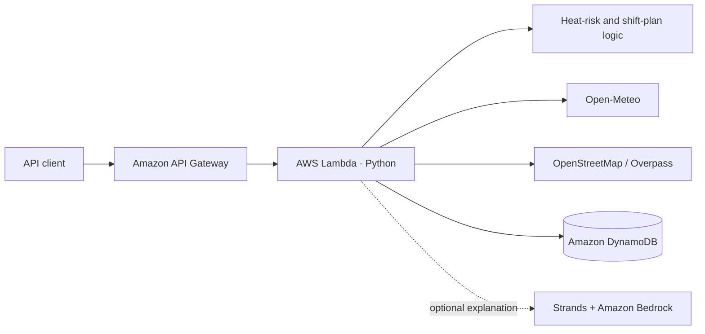

<div align="center">

# ☀️ ShiftCool

### Heat-safety guidance and drinking-water information for outdoor workers

**Understand the heat. Plan the shift. Find water nearby.**

<a href="https://github.com/Alcatraz234156/SHIFTCOOL"></a>


<a href="LICENSE"></a>

<br>

<a href="#get-started">Get started</a>
&nbsp;&nbsp;·&nbsp;&nbsp;
<a href="#how-it-works">How it works</a>
&nbsp;&nbsp;·&nbsp;&nbsp;
<a href="#api-reference">API</a>
&nbsp;&nbsp;·&nbsp;&nbsp;
<a href="#deploy-to-aws">Deploy</a>

</div>

<br>

> **Built for Environmental Hacks · Track 2: Heat and Water**

ShiftCool brings a heat-risk dashboard, shift-planning interface, and nearby drinking-water map together in one prototype. Its Python API provides hourly forecasts, transparent heat-risk calculations, and community water-point reports.

> **Prototype status:** The dashboard currently uses bundled sample data. The backend API is implemented separately; the dashboard views are not yet connected to it.

## At a glance

| Heat screening | Shift planning | Water discovery |
| --- | --- | --- |
| Review hourly conditions and a humidity-adjusted screening indicator. | Explore sample work/rest guidance, with backend recommendations available through the API. | Browse sample map locations; the API can search OpenStreetMap for mapped drinking-water points. |

### What’s in the project

- **Interactive React dashboard** with heat, shift-planning, and water-map views.
- **Python API on AWS Lambda** for Open-Meteo forecasts, deterministic risk records, shift recommendations, and water-point reports.
- **OpenStreetMap / Overpass lookup** for mapped drinking-water locations.
- **DynamoDB report storage** for community status updates.
- **Optional Strands and Amazon Bedrock explanations**, disabled by default.

## How it works

The API turns a location into forecast records and a transparent risk summary. It can also look up mapped water points and combine them with saved community reports.



The repository also includes a React dashboard with sample fixtures. Its current views are not wired to the API client yet.

## Get started

### Run the dashboard

Requirements: Node.js 18 or newer and npm.

```powershell
cd frontend
npm install
npm run dev
```

Open the local URL printed by Vite, usually `http://localhost:5173`. The dashboard loads its bundled sample data without an API configuration.

To build the frontend:

```powershell
npm run build
```

The production bundle is written to `frontend/dist/`.

### Build and run the API locally

Requirements: Python 3.12, AWS CLI, and AWS SAM CLI.

```powershell
cd backend
python -m venv .venv
.\.venv\Scripts\Activate.ps1
python -m pip install -r requirements.txt
sam validate
sam build
sam local start-api
```

The local API is usually available at `http://127.0.0.1:3000`. Weather requests use Open-Meteo; water-point requests use Overpass and read report data from DynamoDB. DynamoDB-backed routes need access to a configured table.

The frontend API client reads `VITE_API_BASE_URL` from `frontend/.env.local`. To point it at a deployed API, create the local env file:

```powershell
cd frontend
Copy-Item .env.example .env.local
```

Set `VITE_API_BASE_URL` in `.env.local` to the API Gateway URL. The dashboard views still use sample data until they are connected to that client.

### Run backend unit tests

From `backend/`:

```powershell
python -m pip install pytest
python -m pytest tests
```

## API reference

Successful responses are JSON. Errors use `{ "error": "message" }`.

| Method | Route | Purpose |
| --- | --- | --- |
| `GET` | `/health` | Check API health. |
| `GET` | `/weather?latitude={lat}&longitude={lon}` | Return two days of hourly forecast and risk records. |
| `POST` | `/shift-plan` | Create recommendations from an `hourly_risk` array. |
| `POST` | `/explain` | Explain a supplied plan when optional AI explanations are enabled. |
| `GET` | `/water-points?latitude={lat}&longitude={lon}&radius_m={meters}` | Find mapped drinking-water points and report summaries. |
| `POST` | `/water-points/{point_id}/reports` | Save a community status report. |

Example shift-plan request:

```json
{
  "hourly_risk": [
    {
      "time": "2026-10-10T12:00",
      "temperature_c": 36.2,
      "relative_humidity": 58,
      "wind_speed_kmh": 11,
      "apparent_temperature_c": 41.0,
      "risk_level": "very_high"
    }
  ]
}
```

Water-report statuses are `Working`, `Dry / not working`, and `Unable to verify`.

## Heat-risk method

The backend calculates a humidity-adjusted screening temperature:

```text
apparent temperature = air temperature
                     + (relative humidity / 100)
                     × max(0, air temperature - 14°C)
                     × 0.35
```

| Apparent temperature | Screening band |
| ---: | --- |
| `< 27°C` | Lower |
| `27–31.9°C` | Moderate |
| `32–40.9°C` | High |
| `≥ 41°C` | Very high |

These bands are a decision-support indicator, **not WBGT**. The calculation does not account for solar radiation, wind exposure, clothing, exertion, acclimatization, shade, medical factors, or workplace controls. Follow local heat-safety guidance, employer procedures, supervisor instructions, and emergency protocols. A lower indicator does not guarantee safe working conditions.

## Deploy to AWS

From `backend/`:

```powershell
sam build
sam deploy --guided
```

The SAM template defines the Lambda function, API Gateway routes, DynamoDB reports table, and an encrypted S3 bucket. After deployment, use the `ApiUrl` output as `VITE_API_BASE_URL` when configuring the frontend API client.

AI explanations are disabled by default. To enable them, set `ENABLE_AI_EXPLANATION=true` for the Lambda and ensure the selected Bedrock model is available and permitted in your AWS region. Review AWS costs and hackathon rules before enabling it.

## Repository layout

```text
SHIFTCOOL/
├── backend/
│   ├── src/
│   │   ├── app.py              # Lambda routes and external integrations
│   │   ├── heat_risk.py        # Deterministic risk calculations
│   │   └── ai_explanation.py   # Optional Strands / Bedrock explanation
│   ├── tests/
│   ├── requirements.txt
│   └── template.yaml           # SAM resources and API routes
├── frontend/
│   ├── src/
│   │   ├── components/         # Dashboard views
│   │   ├── services/           # Sample data and API client
│   │   └── types/              # TypeScript domain types
│   ├── .env.example
│   └── package.json
├── LICENSE
└── README.md
```

## Data and responsible use

- Forecasts are estimates and can change.
- OpenStreetMap data may be incomplete, stale, inaccessible, or incorrectly tagged.
- A map point does not prove that drinking water is currently available.
- Community reports can be uncertain or outdated; check freshness and confidence information.
- Respect the Overpass API usage policy and rate limits.
- ShiftCool is decision-support software, not a medical, occupational-health, or emergency-response system.

## License

This project is licensed under the [MIT License](LICENSE).
